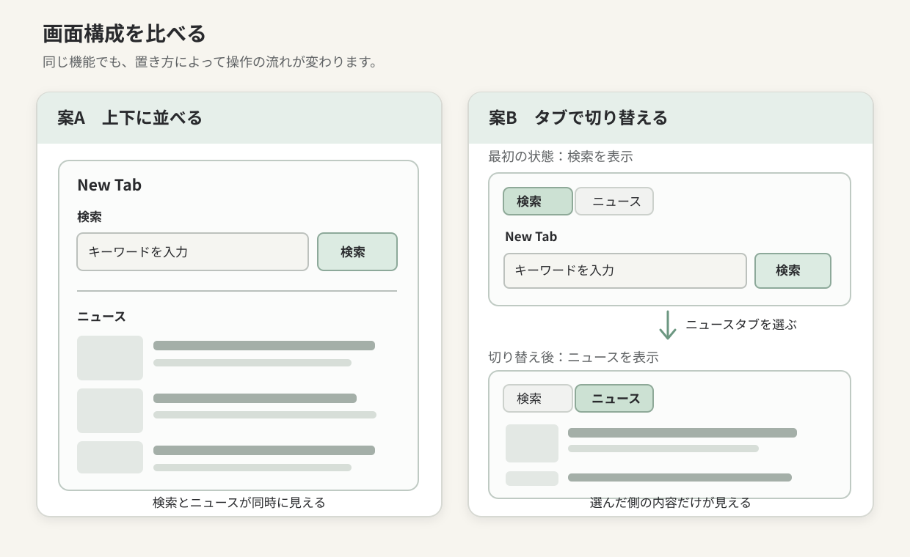

<!-- chapter-id: 01 -->
<!-- goal: 利用場面から画面の役割と情報の優先順位を決め、設計案を比較して説明できる -->
<!-- print:title-page title="プログラミングをする前に" subtitle="画面の骨格を理解する" -->
# 第1章　作りたいページを設計する

## 1.1 New Tab：コードを書く前に考えること

本書では、検索とニュースの確認を一つの画面にまとめた「New Tab」というWebアプリを教材にします。New Tabとは、ブラウザで新しいタブを開いたとき、最初に使うことを想定したページです。調べたいことが浮かんだらすぐ検索し、少し時間があるときにはニュースを確認できる、そんな開始画面を目指します。

画面の目的が曖昧なままコードを書き始めると、何を優先して作るべきか、できあがったものが使いやすいかを判断しにくくなります。デザインの制作でラフスケッチを描くように、Web制作でも先に画面の骨格を考えることができます。この段階ではコードを一行も書けなくて構いません。

本章の目標は、「利用場面から必要な情報を選び、複数の設計案を比較して、その選択理由を説明できるようになること」です。

## 1.2 利用場面から操作を考える

New Tabは繰り返し開くことを想定した画面です。本書では、次の二つの利用場面を出発点にします。

**場面A：すぐに検索したい。** レポート中に知らない言葉を検索するため、新しいタブで検索語を入力して実行します。検索欄が見つけやすく、入力までの操作が少ないことが重要です。

**場面B：ニュースを確認したい。** 作業の合間に記事を探し、必要ならリンクを開きます。見出しに加えて説明や配信元があると、記事を選びやすくなります。

ここで、機能を数える前に「最初に何をしたいか」に注目します。本書では**検索を主な入口とし、ニュースは必要なときに表示する**方針を採用します。これはWebの仕様で決まっていることではなく、想定した利用場面に合わせた筆者の設計判断です。

## 1.3 情報の優先順位を決める

画面に置く情報や操作を整理するため、まず「利用者がすること」と「そのために必要なもの」を対応させます。

| 画面 | 主な操作 | 必要な情報・部品 |
| --- | --- | --- |
| 検索 | 語句を入力して送信する | 入力欄、検索ボタン |
| ニュース | 見出しを見て記事を選ぶ | 見出し、説明、画像、配信元、記事へのリンク |

この表は、完成した機能の一覧というより、設計時の確認表です。たとえば検索欄は、装飾が少なくても「文字を入力する場所」と分かる必要があります。ニュースでは、画像だけでなく見出しが読めること、記事を選ぶための手がかりがあることが重要です。

**情報の優先順位**とは、画面を使う目的に対して、何を先に見せ、何を後から見せるかという考え方です。

## 1.4 画面の設計：二つの案を比べる

構成を決めるときには、最初に思いついた案だけで進まず、比べてみます。今回は、検索とニュースを**上下に並べる案**と、**タブで切り替える案**を考えます。



*図 V-01-001：検索とニュースを配置する二つの案。いずれも設計用のワイヤーフレームであり、実際に動く画面ではありません。*

このような、部品の配置や大きさの関係を簡単な線や箱で描いた図を**ワイヤーフレーム**と呼びます。色やフォントを細かく決める前に、どこに何を置くかを確認するための図です。紙とペンでも、図形を描けるアプリでも作れます。

| 比較する観点 | 案A：上下に並べる | 案B：タブで切り替える |
| --- | --- | --- |
| 検索を始める | ページ上部の検索欄を使える | 初期表示を検索にすれば検索欄を使える |
| ニュースを見つける | 同じページ内に見えている | ニュースタブを選ぶ必要がある |
| 一度に見える情報 | 検索とニュースの両方 | 選択した側の情報だけ |
| 画面の縦の長さ | 記事数によって長くなりやすい | 検索を表示している間は短くできる |
| 設計・実装で注意すること | 情報の区切りと見やすさ | 切り替え操作、選択状態、操作しやすさ |

この比較から、本教材では**案B：タブで切り替える構成**を採用します。検索を主な入口とする利用場面を重視したためです。ただし、ニュースを常に確認したい場合は案Aが適しており、適切な構成は利用目的によって変わります。

## 1.5 「画面がどう変わるか」も設計する

画面設計では、最初に見える静止画だけでなく、操作の前後も考えます。本教材のタブ構成には、少なくとも次の状態があります。

| 状態 | 画面に表示する内容 | 利用者が次にできること |
| --- | --- | --- |
| 最初に開いたとき | 検索欄と検索ボタン | 語句を入力し、検索する |
| ニュースタブを選んだとき | ニュースの表示領域 | 記事を確認する |
| ニュースの取得中 | 「取得しています…」などの案内 | 処理中であると理解する |
| 記事が表示できないとき | 記事がない、または通信失敗を知らせる案内 | 状況を把握し、必要なら別の操作を試す |

ニュースは外部から取得する予定なので、要求した直後に必ず記事が表示されるとは限りません。通信に時間がかかったり、記事が返らなかったり、接続に失敗したりする場合があります。設計の段階からこうした状態を想定しておくと、後の章で取得中やエラーの表示を作る際に、何を伝えるべきか考えやすくなります。

## 1.6 画面の骨格を部品に分ける

案Bを採用したら、次は画面を部品に分けてみます。たとえば「検索／ニュースのタブ」「アプリの見出し」「検索の入力欄とボタン」「ニュースを表示する領域」というまとまりです。これらを整理すると、後からHTMLで内容の構造を作りやすくなります。

第2章以降で使うHTMLの考え方を、ここで少しだけ先取りしてみましょう。後の章で実際に登場するニュースタブには、次の記述があります。

```html
<button id="tab-news" type="button" class="filetab"
  role="tab" aria-selected="false" aria-controls="panel-news" tabindex="-1">2 ニュース</button>
```

これは後続章で使うHTMLの抜粋です。「2 ニュース」タブと`panel-news`が対応している点だけ確認しましょう。

## 1.7 HTML・CSS・JavaScriptは何を担当するか

本書では、役割を分けながらNew Tabを作っていきます。設計段階で分担を見通しておくと、完成後に調べる場所を考えやすくなります。

| 技術 | 主な役割 | New Tabで担当する例 |
| --- | --- | --- |
| HTML | 内容と構造を表す | タブ、見出し、検索フォーム、ニュース領域 |
| CSS | 見た目と配置を整える | 配色、余白、タブの外観、画面幅に応じた配置 |
| ブラウザ側のJavaScript | 操作や状態の変化を扱う | タブ切り替え、検索欄へのフォーカス、ニュースの受信と表示 |
| Node.js側のJavaScript | サーバーで動く処理を担当する | 外部ニュースAPIへの問い合わせ、APIキーの管理 |

**Node.js**はブラウザ外でJavaScriptを動かす環境、**API**は外部サービスの窓口です。ニュース取得に使う**APIキー**はブラウザ側へ埋め込まず、サーバー側で管理します。

これはすべてのWebページにNode.jsが必要という意味ではありません。今回のニュース取得という目的に合わせた構成です。第1章では技術の詳細よりも、**画面に見えるものと、その裏で動く処理は分けて考えられる**ことを押さえましょう。

## 1.8 思いつかない場合：既存の画面から学ぶ

どんな画面にすればよいか思いつかないときは、普段使っているWebサイトやアプリを観察してみましょう。
「ネットサーフィンをする」という方法も、観察する目的を持つと制作に結び付きます。

たとえば、検索サイトやニュースサイト、普段使っている学内システムを開き、次の点を注視してみましょう。

- 最初に目が向かうものは何か。入力欄、見出し、ボタンのどれが目立つか。
- 操作する前と後で、画面のどこが変わるか。
- 情報が取得できないとき、どのような案内が表示されるか。
- キーボードだけで目的の操作を進められるか。

一つのサイトをそのまま模写するのではなく、**何を参考にし、なぜ自分の画面に取り入れたいのか**を言葉にします。たとえば「検索欄を大きくする」「ニュースは必要なときだけ見せる」のように、見た目ではなく役割として記録するとよいでしょう。参考にしたサイトの名前やURL、確認した日付も残しておけば、後から自分の判断の根拠がぶれることを防げます。

AIは画面案の比較に使えますが、利用者を実際に調査した結果ではありません。採用理由は利用場面と観察をもとに説明しましょう。

## 1.9 試す：二つのワイヤーフレームを作る

ここでは、紙とペン、または図形ツールを使って設計を実験します。図 V-01-001を参考に、次の順番で進めてください。

1. **変更前を確認する。** 何も配置していない紙に、「新しいタブを開いて検索したい」「ニュースの見出しを読みたい」という二つの目的を書きます。
2. **結果を予測する。** 検索とニュースを上下に並べた場合、どちらの作業がしやすそうか、自分の予想を一文で書きます。
3. **案Aを描く。** 上に検索欄、下にニュースの見出しを数件置くワイヤーフレームを描きます。文字や箱は簡略化して構いません。
4. **案Bを描く。** 上に「検索」「ニュース」のタブを置き、最初は検索欄が見える案を描きます。ニュースタブを選んだ後の状態も、もう一枚描きます。
5. **操作を確認する。** 指やペン先を使って、「新しいタブを開いて検索語を入力する」「ニュースの見出しを読む」という流れをそれぞれたどります。どの操作で迷うか、何回タブを切り替える必要があるかを記録します。
6. **理由を説明し、比較を終える。** 最初の予想と比べて、どちらを選ぶかを記録します。案A・案Bの元の図も残しておきましょう。後から変更した理由を振り返る材料になります。

操作数だけで優劣を決めないことも大切です。案Aではニュースが目に入りやすく、案Bでは検索だけに集中しやすいかもしれません。どちらの利点を優先するかは、最初に想定した利用場面で判断します。

## 1.10 考える：設計の根拠と技術の仕様を分ける

検索を最初に見せるのはHTMLの決まりではなく、本書の利用場面に基づく設計です。タブの操作方法には別途、参照できる指針があります。

W3Cの**WAI-ARIA Authoring Practices Guide**には、タブと対応するパネルをどのように表し、キーボードで操作できるようにするかを説明した「Tabs Pattern」があります。第1章でその属性名を覚える必要はありませんが、後から自分の設計が技術的に適切か確かめるための資料があることを知っておきましょう。この資料は、筆者が検索を優先した理由を証明するものではなく、**タブという仕組みを実装するときの参考資料**です。

MDN Web Docsの「ウェブサイトをどんな外見にするか」でも、コードを書く前に目的や内容を整理し、簡単なスケッチを描く方法が紹介されています。こちらは設計作業を進めるための学習資料です。資料に書かれていることと、自分が実際に確認したこと、まだ検証していない予想を分けておくと、AIや他人の提案を採用するときにも判断しやすくなります。

## 1.11 章末課題：自分の設計案を説明する

実験で作った二つの案のうち、一つを選んで短い設計メモにまとめてください。次の四点を含めます。

- **利用場面**：誰が、いつ、何のために使う画面か。
- **情報の優先順位**：最初に見せるものと、後から見せるものは何か。
- **採用理由**：別の案と比べて、なぜその構成を選んだか。
- **未確認のこと**：実際の利用者に試してもらうまで分からない点は何か。

余裕があれば、学友にワイヤーフレームを見せ、検索を始める場所とニュースへ進む場所を指してもらいましょう。説明せずに伝わったかを観察し、分かりにくかった部分を一か所だけ直します。変更後、同じ操作をもう一度確かめます。

この課題は、デザインの正解を当てるためではありません。「こう使ってほしい」という予想を、他者の反応や自分の操作で確かめ、小さく改善する練習です。この方法は、第7章のデバッグや第8章の改善サイクルにもつながります。

## 1.12 ふりかえり：設計をHTMLへつなぐ

本章では、New Tabで何をしたいかを整理し、検索とニュースを上下に並べる案とタブで切り替える案を比較しました。検索を最初に見せるという方針は、今回の利用場面から選んだ設計判断です。また、取得中や失敗時のように、通常の画面以外の状態も考えておく必要があることを学びました。

最初の段階で大切なのは、**作る目的を言葉にし、画面の部品と操作の関係を描き、採用した理由を説明できること**です。設計は一度決めたら変えてはいけないものではなく、作りながら、使いながら見直していくものです。
