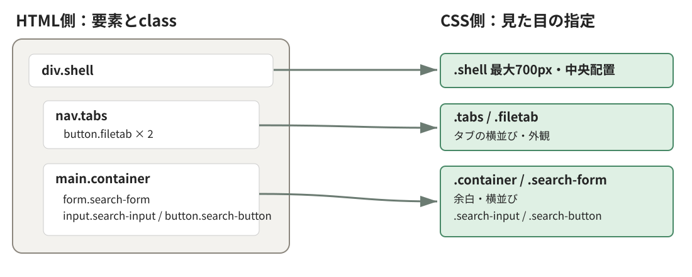
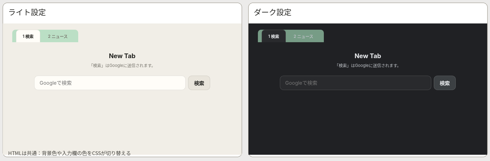
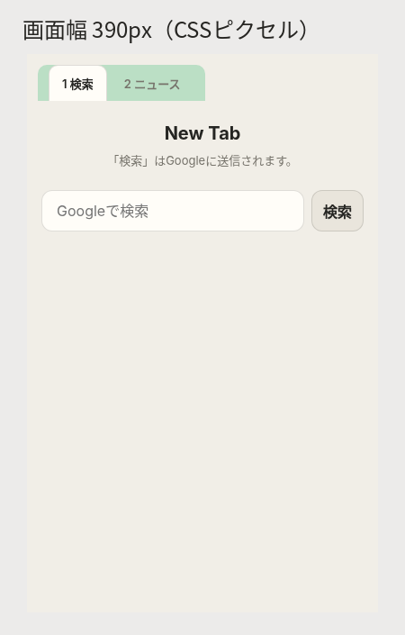

<!-- chapter-id: 03 -->
<!-- goal: CSSの指定が画面のどの見た目に影響するかを説明し、小さな変更を検証できる -->
# 第3章　CSSでデザインを整える

*HTMLの構造と画面の見た目を結び付け、変更の結果を自分で確かめる*

## 3.1 知る：HTMLの骨格にデザインを加える
CSSはHTMLの要素の**見た目**を指定します。本章では色・余白・配置の指定が画面にどう反映されるかを見て、一か所変更します。

## 3.2 知る：CSSの基本的な書き方と読み込み方

### 3.2.1 セレクターと宣言

CSSは、基本的に「どの要素に対して」指定するのかを決め、その要素の「どの見た目を」「どの値にするか」を記述します。

```txt
セレクター {
  プロパティ:プロパティ値;
}
```

という記述の仕方となります。実例を見てみましょう。

```css
.subtitle {
  color: var(--text-muted);
  font-size: 13px;
}
```

`.subtitle`は**セレクター**と呼ばれ、`class="subtitle"`の要素を選びます。波括弧内の`color`や`font-size`は**プロパティ**、右側の値は**プロパティ値**です。`color: var(--text-muted);`のような組を**宣言**と呼びます。次のHTMLは説明文に`subtitle`を指定しています。

```html
<p class="subtitle">「検索」はGoogleに送信されます。</p>
```

HTMLの`class`とCSSのセレクターが対応し、プロパティと値が見た目を指定します。複数の指定が重なる場合の優先関係は**カスケード**と呼びます。この対応を図V-03-001で確認してください。

### 3.2.2 CSSファイルをHTMLから読み込む

教材の`index.html`には、`head`内に次の記述があります。

```html
<link rel="stylesheet" href="style.css">
```

`link`要素は、HTML文書と外部の資料を関連付けます。ここでは`rel="stylesheet"`でスタイルシートであることを示し、`href="style.css"`で読み込むファイルを指定しています。`style.css`は次のように**同じフォルダー**へ配置すると読み込めます。

```text
03-css/
├── index.html
└── style.css
```

CSSが読み込まれていなくても、HTMLの見出しや検索欄は通常表示されます。ただし、その見た目にはブラウザの標準スタイルが用いられます。この違いは、後の演習で実際に確認します。

## 3.3 読み解く：画面全体とCSSの対応をつかむ

対象のHTMLは`div.shell`の中に`nav.tabs`と`main.container`があり、後者に見出し・説明文・検索・ニュースの領域が入っています。



*図3-1　HTMLの構造とCSSセレクターの対応。左側のHTML要素に付いたclassが、右側のレイアウト指定の対象になります。*

この関係を整理すると、教材のCSSは次のように分担されうることが想像できます。

| CSSの対象 | 対応する画面の部分 | 主に指定していること |
|---|---|---|
| `body`, `.shell`, `.container` | ページ全体と中央の内容領域 | 背景、最大幅、余白 |
| `.tabs`, `.filetab` | 「1 検索」「2 ニュース」のタブ | 横並び、形、選択中の外観 |
| `h1`, `.subtitle` | 見出しと説明文 | 文字の大きさ、色、中央揃え |
| `.search-form`, `.search-input`, `.search-button` | 検索欄と検索ボタン | 横並び、幅、背景、境界線 |
| `.news-card`, `.news-item`など | ニュース表示領域 | カードや記事の外観（現段階では非表示） |

重要なのは、**画面に存在する部分と、今見えている部分は同じではない**という点です。ニュースパネルにはHTMLで`hidden`属性が指定され、初期状態では表示されません。`hidden`が解除された際のスタイルを先行して書いていることに留意しましょう。

## 3.4 読み解く：色に名前を付けて再利用する

### 3.4.1 カスタムプロパティでデザインの基準をまとめる

共通の色をまとめて管理するため、**CSSカスタムプロパティ**を使います。`--page`や`--surface`はCSSの値に付けた名前です。

<!-- source: chapters/new-tab-8chapters/03-css/style.css#L2-L26 -->
```css
:root {
  color-scheme: light;
  --page: #f1eee7;
  --surface: #fffdf8;
  --surface-muted: #e9e5dc;
  --text: #252522;
  --text-muted: #77746c;
  --border: rgba(40, 38, 32, .15);
  --focus: #487b61;
  --error: #b3261e;
  --radius: 12px;
}
@media (prefers-color-scheme: dark) {
  :root {
    color-scheme: dark;
    --page: #202124;
    --surface: #292a2d;
    --surface-muted: #3c4043;
    --text: #e8eaed;
    --text-muted: #bdc1c6;
    --border: rgba(255, 255, 255, .18);
    --focus: #a4d9bb;
    --error: #ffb4ab;
  }
}
```

`:root`は通常のHTML文書で`html`要素を選びます。ここに`--page`（背景）や`--text`（文字色）などを定義し、各所から使います。`--radius`は角の丸みです。

カスタムプロパティを使うときは、次のように`var()`で参照します。

```css
body {
  background: var(--page);
  color: var(--text);
}
.search-input {
  background: var(--surface);
  border-radius: var(--radius);
}
```

### 3.4.2 ダークモードでは何が切り替わるのか

先ほどのコードにある`@media (prefers-color-scheme: dark)`は、**メディアクエリ**です。閲覧環境などの条件に応じてCSSの一部を適用する仕組みです。ここでは、OSやブラウザがダーク配色を希望している場合に、その中の指定が適用されます。

ライト時の`--page`は`#f1eee7`、ダーク時は`#202124`です。同じ`background: var(--page)`でも、参照する値に応じて背景が変わります。



*図3-2　同じHTMLをライト設定とダーク設定で表示した比較。教材HTMLとCSSをブラウザで描画した例。*

`color-scheme`は入力欄などブラウザが描く部品の配色を知らせます。ページ独自の色を変える`--page`とは役割が違います。

## 3.5 読み解く：大きさと余白からレイアウトを理解する

### 3.5.1 ページの幅を制限して中央に配置する

ページ全体の配置を担当するコードを見ます。以下は教材の一部を抜粋したものです。

```css
*, *::before, *::after { box-sizing: border-box; }
body {
  margin: 0;
  min-height: 100vh;
  padding: 20px 32px;
  background: var(--page);
  color: var(--text);
  font-family: 'Noto Sans JP', Inter, system-ui, sans-serif;
}
.shell { width: min(700px, 100%); margin: 0 auto; }
.container { padding: 24px; }
```

**ボックスモデル**は内容・余白・境界線からなる大きさの考え方です。`box-sizing: border-box`では、指定した幅や高さに`padding`と`border`を含めます。

### 3.5.2 タブを横に並べ、選択状態を見せる

タブ部分では、次の指定が重要です。必要な部分だけを抜粋しています。

```css
.tabs {
  display: inline-flex;
  gap: 4px;
  padding: 0 12px;
  background: rgba(161, 215, 181, .68);
  border-radius: 10px 10px 0 0;
}
.filetab {
  min-width: 64px;
  height: 40px;
  padding: 0 20px;
  border: 1px solid transparent;
  border-bottom: 0;
  border-radius: 10px 10px 0 0;
  background: transparent;
  color: var(--text-muted);
  font-size: 13px;
  font-weight: 600;
  cursor: pointer;
}
.filetab[aria-selected="true"] {
  background: var(--surface);
  border-color: var(--border);
  color: var(--text);
}
```

`.tabs`の`display: inline-flex`は、子要素を並べる**Flexbox（フレックスボックス）**というレイアウトの仕組みを使い、タブ全体を内容に応じた幅のまとまりとして扱います。

`.filetab[aria-selected="true"]`は、`aria-selected="true"`のタブを選ぶ**属性セレクター**です。選択中のタブの色を変えるために使います。

ただし、**CSSが属性を読んで色を変えることと、クリックで属性を書き換えることは別です**。CSSによる状態の「表現」と、JavaScriptによる状態の「変更」は異なるものであることを留意しましょう。

### 3.5.3 検索フォームは入力欄の幅を柔軟にする

検索フォームのHTMLは、`form.search-form`の中に入力欄と検索ボタンを配置しています。CSSでは次のように指定しています。

```css
.search-form {
  display: flex;
  gap: 8px;
  margin: 24px auto;
  max-width: 560px;
}
.search-input {
  flex: 1;
  min-width: 0;
  padding: 12px 16px;
  border: 1px solid var(--border);
  border-radius: var(--radius);
  background: var(--surface);
  color: var(--text);
}
```

`display: flex`で検索欄とボタンを横並びにし、`gap: 8px`で間隔を空けます。`max-width: 560px`で全体幅を制限し、`flex: 1`と`min-width: 0`で入力欄を伸縮させます。

```text
form.search-form（横並び・最大560px）
┌────────────────────────────────┐ 8px ┌──────────┐
│ input.search-input（flex: 1）   │←gap→│ 検索ボタン│
└────────────────────────────────┘     └──────────┘
```

*図3-3　検索フォームの横並び構造を表した模式図。実際の寸法を正確な縮尺で示したものではありません。*

`flex: 1`を外した場合、入力欄は残りの横幅を同じようには埋めなくなります。このように、一つの宣言を変更した影響を具体的に予想できることが、CSSを理解する第一歩です。

## 3.6 読み解く：見えるデザインと操作しやすさ

デザインは見た目だけで完結するものではありません。キーボード操作や支援技術からの利用を考える必要もあります。教材には、次のような指定があります。

```css
.search-input:focus {
  outline: 2px solid var(--focus);
  outline-offset: 2px;
}
.filetab:focus-visible, .search-button:focus-visible,
.refresh-button:focus-visible, .news-item a:focus-visible {
  outline: 2px solid var(--focus);
  outline-offset: 3px;
}
.sr-only {
  position: absolute; width: 1px; height: 1px; padding: 0;
  margin: -1px; overflow: hidden; clip-path: inset(50%);
  white-space: nowrap; border: 0;
}
```

`:focus`はフォーカス中、`:focus-visible`はフォーカスの目印が必要と判断された状態を選びます。`outline`は輪郭線です。クリックとTabキーで違いを確認しましょう。

一方、`.sr-only`は要素を画面上ではほとんど見えない状態にするためのclassです。検索欄のHTMLには`<label class="sr-only" for="search-input">検索キーワード</label>`があります。ラベルの説明は視覚的には隠しながら、支援技術に伝える情報として残す目的で用いられています。**表示しないことと、情報そのものを削除することは異なる**ことを把握しておきましょう。

ニュース領域については、CSSに`.news-card`や`.news-item`のほか、`.refresh-button`、`.news-notice`、`.error`などの指定があります。しかし、今回のHTMLには対応する要素がないものもあります。さらに、`#panel-news`には`hidden`が指定されており、CSSでも次のルールを置いています。

```css
[hidden] { display: none !important; }
```

このルールは、`hidden`属性を持つ要素を表示しないようにするものです。ニュース用の見た目は、**後の章に向けて準備されている部分**と考えましょう。

## 3.7 読み解く：画面幅や利用環境に合わせて調整する

### 3.7.1 600px以下で余白を小さくする

教材の末尾には、画面幅に応じた調整が書かれています。

```css
@media (max-width: 600px) {
  body { padding: 12px; }
  .container { padding: 16px 4px; }
  .filetab { min-width: 56px; padding: 0 14px; }
  .news-image { width: 90px; height: 60px; flex-basis: 90px; }
  .search-button { padding: 9px 12px; }
}
```

`@media (max-width: 600px)`は、**表示領域の幅が600 ピクセル以下**のときに内側の指定を適用します。このように表示環境に応じて配置やサイズを調整する考え方を**レスポンシブデザイン**と呼びます。



*図3-4　390px幅での表示例。入力欄とボタンが横並びのまま収まるかを観察できます。実際の端末での見え方は別途確認が必要です。*

### 3.7.2 動きを抑える設定にも配慮する

同じく末尾には、次の指定があります。

```css
@media (prefers-reduced-motion: no-preference) {
  .filetab, .search-button, .refresh-button {
    transition: background .18s ease, color .18s ease;
  }
}
```

`transition`は色の変化を滑らかにします。`prefers-reduced-motion`を使い、動きを減らしたい利用者への配慮も加えています。

## 3.8 考える：CSSを外すと何が残るか

CSSを外すと見た目は変わりますが、HTMLの見出しやフォームの意味、GET送信の仕組みは残ります。

ただし、CSSが「見た目だけ」だから重要でないという意味ではありません。文字の読みやすさ、操作対象の見分けやすさ、狭い画面での操作性などもCSSの影響を受けます。**構造・見た目・動作を分けて理解し、それらが利用者の体験として結び付くこと**を意識してください。

## 3.9 試す：一か所ずつ変更して確かめる

ここでは毎回、作業用コピーを編集し、結果を記録してください。複数の箇所を同時に変えると、どの変更が結果を生んだのか分かりにくくなります。

### 3.9.1 実験A：ページの背景だけを変更する

最初にライト設定で画面を表示し、ページの背景と検索欄の背景が別の色であることを確認します。次に、背景がどう変わるか予測してから、`style.css`の最初の`:root`にある次の一行だけを変更してください。

```css
--page: #dceaf5; /* 実験用：元は #f1eee7 */
```

再読み込みして、ページの背景と検索欄の背景を比べます。ページの背景が変わり、入力欄の表面が別の色のままであれば、`--page`と`--surface`が異なる用途で使われていると説明できます。**ダーク設定では**、後に書かれたダーク用の`--page`が適用されるため、この変更が画面に現れない場合があります。

### 3.9.2 実験B：検索欄とボタンの間隔を変える

ライト設定の検索フォームで、入力欄とボタンの間隔を観察します。`gap`を広げるとどうなるか予測し、`.search-form`にある一行だけを次のように変更します。

```css
gap: 24px; /* 実験用：元は 8px */
```

再読み込みして、入力欄とボタンの間隔が広がることを確認します。フォーム全体の幅が変わらない条件では、間隔が広がった分だけ入力欄に使える幅は減るはずです。`display: flex`と`flex: 1`の関係を意識して説明してください。

### 3.9.3 実験C：境界の前後で表示を比較する

開発者ツールで幅を**601px→600px→390px**に変え、余白を比べます。600px以下では`body`の`padding`が`12px`になります。はみ出しも確認しましょう。

## 3.10 根拠を確かめる：開発者ツールと公式資料

開発者ツールは、ブラウザが現在どのHTMLやCSSを使用して表示しているかを調べる機能です。Chromeなどでは画面上で右クリックして「検証」を選び、**Elements**と**Styles**（またはそれに相当する画面）を使います。

開発者ツールで`.search-input`を選び、Stylesの`background: var(--surface)`とComputedの色を確認します。変更を保存する場合は元のCSSファイルを編集しましょう。

ダークモードは、OSの設定を変更するほか、Chrome DevToolsの**Rendering**にある`prefers-color-scheme`のエミュレーションでも試せます。表示を切り替えたとき、`--page`や`--text`の計算結果がどう変化するか確認してください。ただし、エミュレーションでの確認を、そのまま実機での検証と同一視してはいけません。

分からないことを生成AIに質問する場合は、
>このCSSの`.filetab[aria-selected="true"]`はどのHTMLを選びますか。属性の値を変更せずにクリックした場合の挙動も説明してください
のように**実際のコードを示して質問**します。回答のうちCSSの仕様はMDNなどの公式資料で、教材固有の挙動は開発者ツールで検証しましょう。

## 3.11 章末演習と発展課題

次の問いに、CSSとHTMLを見ながら答えてください。可能な場合は予測を立てましょう。

1. `.subtitle`の先頭に`.`が付く理由は何でしょうか。HTMLのどの要素に対応していますか。
2. `--surface`の値を変えたとき、検索欄の背景はどうなるでしょうか。ページの背景が必ず同じ色に変わるでしょうか。
3. `.filetab[aria-selected="true"]`が選ぶ要素は、初期状態ではどちらのタブでしょうか。ニュースタブをクリックすると自動的に変わりますか。
4. `max-width: 600px`という条件は、600pxちょうどの表示領域にも当てはまるでしょうか。
5. CSSを読み込まない状態でも、検索フォームが送信できる理由をHTMLの記述から説明してください。

**発展課題：** `--radius`だけを`12px`から`4px`へ変更し、検索欄と検索ボタンの角がどう変わるか観察してください。次に、`.filetab`の角は同じように変わるか予想してから確認します。結果が異なる場合は、`.filetab`が`var(--radius)`ではなく、独自の`border-radius`を使っていることをコードから説明できます。

答えを確かめる際は、単に「変わった・変わらなかった」と書くのではなく、**変更した宣言→選ばれた要素→画面上の結果**を一続きで説明してください。これが、生成AIが提示したCSSを自分で評価するときにも役立ちます。

## 3.12 ふりかえり：見た目と動作を分けて理解する

本章では、第2章で作ったHTMLにCSSを読み込み、タブや検索フォームの外観がどのように決まるかを調べました。`.shell`は内容の幅を整え、Flexboxはタブや検索フォームを横並びにし、カスタムプロパティは色や角の丸みを再利用する役割を持っていました。メディアクエリによって、配色の希望や画面幅、動きの軽減設定に応じた指定も用意されていました。

ここで身につけてほしいのは、CSSのプロパティ名を数多く暗記することではありません。**画面上の一部分を選び、対応するHTMLとCSSを探し、変更の影響を予測して検証する方法**です。今後、他人が書いたコードや生成AIが提案したコードを使うときにも、この手順が判断の根拠になります。

次の第4章ではJavaScriptを使い、タブの操作に応じて表示するパネルを切り替えていきます。本章で学んだ`.filetab[aria-selected="true"]`のような指定は、JavaScriptによって状態が更新されると、その結果を見た目に反映する役割を担います。**HTMLの構造、CSSの表現、JavaScriptの処理**がどのように結び付くかを意識しながら進んでください。
