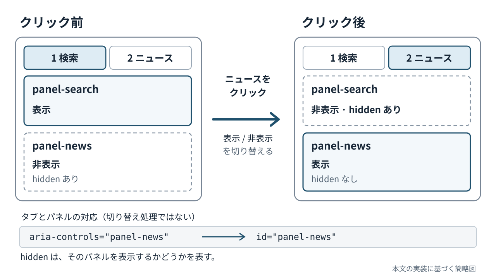

 
<!-- chapter-id: 04 -->
<!-- goal: DOM要素とクリックイベントの関係を読み解き、タブの表示状態を検証できる -->

# 第4章　JavaScriptでタブを動かす

## 4.1 知る：見た目を整えたタブに動作を加える

前章では、HTMLにCSSを適用し、タブや検索フォームの見た目を整えました。しかし、CSSは「どのタブが選ばれたか」をクリックから判断してくれるわけではありません。

本章では、JavaScriptを使って、利用者がタブを選ぶと対応する内容だけが表示されるようにします。完成した「New Tab」のうち、扱うのは「1 検索」と「2 ニュース」の切り替えです。すでにあるHTMLとCSSに、操作に応じた状態の変更を結び付けることが目標です。

## 4.2 知る：JavaScript、DOM、イベントの役割

HTMLは**構造**を記述するものでした。またCSSは**見た目**を指定するものでした。
これに対してJavaScriptは、利用者の操作などに応じて、ページの**状態や動作**を変えるために使います。

ブラウザは読み込んだHTMLを、JavaScriptから参照・変更できる要素の集まりとして扱います。この仕組みを**DOM（Document Object Model）**と呼びます。たとえば、HTMLに書かれた`<button>`は、JavaScriptから取得して属性を読み取ったり、値を変更したりできます。DOMは、HTMLを単なる文字列として探すのではなく、「このボタン」「このパネル」という単位で扱うための仕組みです。

また、クリックやキー入力のような出来事を**イベント**と呼びます。イベントが起きたときに呼び出す処理を登録する仕組みが**イベントリスナー**です。今回の基本的な流れは、次のとおりです。

1. JavaScriptがHTML内のタブとパネルを見つけます。
2. タブがクリックされたときに実行する処理を登録します。
3. クリックが発生すると、JavaScriptが選択状態と表示状態を更新します。
4. ブラウザは更新されたHTMLの状態とCSSに従って画面を表示します。

ここで重要なのは、**JavaScriptがタブの色を直接塗り替えているわけではない**という点です。JavaScriptは選択状態を表す属性を書き換え、CSSがその属性を条件に見た目を変えています。

## 4.3 読み解く：HTMLに用意されたタブとパネル

まず、JavaScriptを読む前に、操作の対象となるHTMLを確認します。`index.html`からタブとパネルの開始部分を抜き出すと、次のようになっています。

```html
<nav class="tabs" role="tablist" aria-label="新しいタブのメニュー">
  <button id="tab-search" type="button" class="filetab"
    role="tab" aria-selected="true" aria-controls="panel-search" tabindex="0">1 検索</button>
  <button id="tab-news" type="button" class="filetab"
    role="tab" aria-selected="false" aria-controls="panel-news" tabindex="-1">2 ニュース</button>
</nav>

<section id="panel-search" class="panel" role="tabpanel" aria-labelledby="tab-search">...</section>
<section id="panel-news" class="panel" role="tabpanel"
  aria-labelledby="tab-news" hidden>...</section>
```

ここでは、二つのタブを`role="tablist"`というまとまりに入れ、各ボタンに`role="tab"`、対応する表示領域に`role="tabpanel"`を指定しています。`role`は、要素がインターフェースの中でどのような役割を持つかを、支援技術に伝えるための属性です。また、`aria-`で始まる属性は、要素の関係や状態を伝えるために用いられます。

| 画面上の部分 | タブの`id` | タブの`aria-controls` | 対応するパネルの`id` |
| --- | --- | --- | --- |
| 1 検索 | `tab-search` | `panel-search` | `panel-search` |
| 2 ニュース | `tab-news` | `panel-news` | `panel-news` |

`aria-controls="panel-news"`はニュースタブから対象パネルを指します。`aria-labelledby="tab-news"`はパネルの名前付けにタブを使う指定です。JavaScriptもこの対応を参照します。



*図 V-04-001：タブ選択前後の表示。破線は非表示のパネルを示す。*

最初のHTMLでは、検索タブに`aria-selected="true"`、ニュースタブに`aria-selected="false"`が付いています。ニュースパネルには`hidden`があるため、ページを開いた直後は検索パネルが表示される構成です。まず、この状態を覚えておいてください。

## 4.4 読み解く：`tabs.js`全体で行っていること

今回のJavaScriptは、`tabs.js`というファイルにまとまっています。HTMLの`<head>`には次の指定をしてください

```html
<script src="tabs.js" defer></script>
```

`src`は読み込むファイルを指定します。`defer`は、HTMLの解析が終わってからこのスクリプトを実行するようブラウザーへ伝えるための要素になります。これはすべてのタブの要素が読み込まれる前に動作を行わないようにするためです。

`tabs.js`全体の処理は、大きく四つに分けられます。

1. **要素の取得**：タブを集め、それぞれに対応するパネルを取得する。
2. **切り替え処理の定義**：`activateTab`という関数に、選択状態と表示状態の更新をまとめる。
3. **操作の登録**：クリックとAltキーを使った操作から`activateTab`を呼び出す。
4. **初期化**：最後に`activateTab(0)`を実行し、検索タブを選択状態にする。

ここでいう**関数**は、名前を付けてひとまとまりにした処理です。関数を呼び出すことで、同じ変更を複数の操作から実行できます。「要素を見つける→操作を待つ→状態を変える」というJavaScriptの流れを意識してください。


ここで`const`、`let`、`function`を確認します。
`const`は再代入できない変数、`let`は再代入できる変数、`function`は処理をまとめる関数です。

## 4.5 読み解く：タブとパネルを取得する

最初に、`tabs.js`冒頭の2行を見ます。

<!-- source: chapters/new-tab-8chapters/04-tabs/tabs.js#L1-L18 -->

```javascript
const tabs = [...document.querySelectorAll('[role="tab"]')];
const panels = tabs.map(tab => document.getElementById(tab.getAttribute('aria-controls')));
```

`document`は、現在のHTML文書をDOMとして扱うための入口です。`querySelectorAll('[role="tab"]')`は、CSSのセレクターと同じ書き方を使って、`role="tab"`を持つ要素をすべて取得します。今回は「1 検索」と「2 ニュース」の二つです。

`querySelectorAll`は要素の集まりである**NodeList**を返します。`[...]`で配列に変えると、`map`などの処理を使えます。

`map`で各タブに対応するパネルを探します。`getAttribute('aria-controls')`で`"panel-news"`を読み、`getElementById`へ渡します。

配列の対応は次のようになります。

| 配列の番号 | `tabs`に入る要素 | `panels`に入る要素 |
| --- | --- | --- |
| `0` | 検索タブ（`tab-search`） | 検索パネル（`panel-search`） |
| `1` | ニュースタブ（`tab-news`） | ニュースパネル（`panel-news`） |

`tabs[1]`と`panels[1]`のように、**同じ番号で対応するものを扱える**ことが、この後の処理の基礎になります。なお、指定した`id`を持つ要素が見つからない場合、`getElementById`は`null`（該当する要素がないことを示す値）を返します。HTMLの名前が一致しているかどうかは、単なる見た目の問題ではなく、JavaScriptの動作に関わります。

ここでJavaScriptにおいて混同しやすい`Null`と`Undefined` について軽くさらっておきます。
• undefined：値が「未定義」でまだ何も割り当てられていない
• null：値が「空」であり意図的に空っぽにしている
といった違いがあります。

## 4.6 読み解く：`activateTab`が三つの状態を更新する

次は、タブ切り替えを担当する関数です。

<!-- source: chapters/new-tab-8chapters/04-tabs/tabs.js#L5-L14 -->

```javascript
function activateTab(index, moveFocus = false) {
  if (index < 0 || index >= tabs.length || !panels[index]) return;
  tabs.forEach((tab, i) => {
    const selected = i === index;
    tab.setAttribute('aria-selected', String(selected));
    tab.tabIndex = selected ? 0 : -1;
    panels[i].hidden = !selected;
  });
  if (moveFocus) tabs[index].focus();
}
```

`activateTab(0)`は検索、`activateTab(1)`はニュースを選びます。冒頭の`if`は不正な番号やパネル欠落時に`return`で処理を止めます。

`forEach`で各タブを調べ、`i === index`が一致するときの`true`を`selected`に入れて状態を更新します。

| コード | 何を変えるか | 画面や操作への影響 |
| --- | --- | --- |
| `tab.setAttribute('aria-selected', String(selected))` | タブの選択状態を表す属性 | 支援技術に選択状態を伝え、CSSの選択条件にも使われる |
| `tab.tabIndex = selected ? 0 : -1` | Tabキーで順番に移動するときの対象 | 選択中のタブだけを通常のTabキー移動の対象にする |
| `panels[i].hidden = !selected` | 対応するパネルの非表示状態 | 選択されていないパネルを隠す |

`setAttribute`で属性を変更し、`String(selected)`で真偽値を`"true"`／`"false"`の文字列にします。`aria-selected`はCSSの選択中表示に使われます。

```css
.filetab[aria-selected="true"] {
  background: var(--surface);
  border-color: var(--border);
  color: var(--text);
}
```

`tabIndex`の`0`は通常のTab移動の対象、`-1`は対象外です。`-1`でもJavaScriptからフォーカスできます。

`!selected`は真偽値を反転します。選択中は`hidden = false`で表示、それ以外は`true`で非表示にします。

たとえば`activateTab(1)`を呼び出した直後の状態を整理すると、次のようになります。

| 要素 | `aria-selected` | `tabIndex` | パネルの`hidden` |
| --- | --- | --- | --- |
| 検索タブ／検索パネル | `false` | `-1` | `true`（非表示） |
| ニュースタブ／ニュースパネル | `true` | `0` | `false`（表示） |

タブの選択状態・Tab移動・表示を同じ関数で更新します。`moveFocus`は既定で`false`のため、現状の呼び出しでは`focus()`による移動は起きません。

## 4.7 読み解く：クリックとAltキーを同じ関数につなぐ

切り替える規則ができたので、次は利用者の操作と結び付けます。クリックを受け取る部分は次のとおりです。

<!-- source: chapters/new-tab-8chapters/04-tabs/tabs.js#L16-L18 -->

```javascript
tabs.forEach((tab, index) => {
  tab.addEventListener('click', () => activateTab(index));
});
```

`addEventListener('click', ...)`でクリック時の処理を登録し、`() => activateTab(index)`で選んだタブの番号を渡します。

<!-- source: chapters/new-tab-8chapters/04-tabs/tabs.js#L20-L29 -->

```javascript
window.addEventListener('keydown', event => {
  if (!event.altKey || event.ctrlKey || event.shiftKey || event.metaKey) return;
  if (event.key === '1' || event.key === '2') {
    const index = Number(event.key) - 1;
    if (index < tabs.length) {
      event.preventDefault();
      activateTab(index);
    }
  }
});
```

`keydown`はキーを押したときのイベントです。`event`から修飾キーと`1`／`2`を確認し、対象の操作だけを受け付けます。

`Number(event.key) - 1`は、キーの文字`"1"`または`"2"`を数値に変え、配列の番号`0`または`1`に合わせる処理です。`event.preventDefault()`は、ブラウザ側で行われる既定の動作を、そのイベントが取り消し可能な場合に抑えるための呼び出しです。

クリックでもAltキーでも、最後に呼び出すのは同じ`activateTab`です。「クリック用の切り替え」「キー操作用の切り替え」を別々に作らないことで、選択状態の更新が食い違う可能性を減らせます。なお、このイベントは`window`に登録されているため、ページ内の別の場所でキーを押しても条件が合えば処理されます。

## 4.8 考える：初期表示と、実装されている範囲

`tabs.js`の最後には、次の一行があります。

<!-- source: chapters/new-tab-8chapters/04-tabs/tabs.js#L31 -->

```javascript
activateTab(0);
```

HTMLだけを読み込んだ時点でも、検索タブには`aria-selected="true"`、ニュースパネルには`hidden`が指定されています。JavaScriptが実行されると、`activateTab(0)`があらためて検索タブを選び、タブとパネルの状態をそろえます。初期表示を明示しておくと、クリックを待つ前に、どちらが選択中かをコードから読み取れます。

JavaScriptを無効にするとタブは切り替わりませんが、検索フォームのGET送信はHTMLの`action`と`method`で動きます。

## 4.9 試す：ブラウザと開発者ツールで状態を確かめる

`index.html`、`style.css`、`tabs.js`を同じフォルダーに置き、`index.html`をブラウザで開きます。検索タブと検索欄が見えることを確認したら「2 ニュース」をクリックし、ニュースパネルの「第6章でニュースを自動取得します。」と検索フォームが隠れる状態を確認します。「1 検索」をクリックすると元に戻ります。

**コンソール（Console）**では、JavaScriptの式を直接入力して値を確認できます。
```javascript
document.getElementById('tab-news').getAttribute('aria-selected')
// 期待する結果: "true"

document.getElementById('panel-news').hidden
// 期待する結果: false
```

`"true"`は属性から取得した**文字列**で、`false`はプロパティの**真偽値**です。同じ状態を調べていても、取り出した値の種類が違うことに注目してください。

## 4.10 試す：一か所だけ変更して結果を予測する

ここからは、小さな変更を加えて検証します。

### 実験1：最初に表示するタブを変える

1. 変更前にページを開き、検索パネルが最初に表示されることを確認します。
2. `activateTab(0)`を`activateTab(1)`にすると、何が表示されるか予測して記録します。
3. `tabs.js`の**最後の一行だけ**を次のように変更します。

   ```javascript
   activateTab(1);
   ```

4. 保存してページを再読み込みし、最初からニュースパネルが表示されること、タブの選択状態もニュースに変わることを確認します。
5. HTMLでは検索タブが選択された状態で書かれているのに、なぜニュースが表示されるのか説明します。手掛かりは、`defer`による実行の順序と`activateTab`の働きです。
6. 最後に`activateTab(0)`へ戻し、検索パネルから始まることを再確認します。

この実験から、HTMLの初期値とJavaScriptによって更新された状態を区別できます。どちらが実際の画面を決めているかを、再読み込み後に確かめるのがポイントです。

### 実験2：HTMLの対応関係を一時的に崩す

1. 変更前にニュースタブで切り替えられることを確認します。
2. `aria-controls`に存在しない`id`を書いた場合、どこで問題が起きるか予測します。
3. `index.html`のニュースタブの属性**一か所だけ**を、`aria-controls="panel-news-test"`に変更します。ニュースパネル側の`id`は変えません。
4. 保存して再読み込みし、画面の状態と開発者ツールのConsoleを確認します。今回のコードでは、`panels[1]`が`null`になり、初期化の途中で存在しないパネルの`hidden`を操作しようとしてエラーが起きることがあります。実際のエラーメッセージも記録しましょう。
5. なぜタブとパネルの名前の不一致がJavaScriptのエラーにつながるのか、`getElementById`、`map`、`panels[i].hidden`を手掛かりに説明します。
6. 属性を必ず`aria-controls="panel-news"`に戻し、再読み込みしてクリック操作が復旧したことを確認します。

対応するパネルを一つ欠けさせると、`activateTab`のループ中にエラーが起こり得ます。現在の存在確認には改善の余地があります。

## 4.11 考える：フォーカスと操作方法をどう設計するか

`moveFocus = false`は引数省略時の既定値です。現状のクリック・Altキー操作では、表示は切り替わりますがフォーカスは移動しません。

発展的な確認として、Altキーの処理にある`activateTab(index);`だけを一時的に`activateTab(index, true);`へ変えると、切り替え先のタブへ`focus()`が呼び出されます。変更前後でConsoleに`document.activeElement.id`と入力し、現在のフォーカス先を比べてみましょう。変更する前に結果を予測し、確認後は元に戻してください。

`aria-selected`は選択状態、`tabIndex`はTab移動の対象、`focus()`はフォーカス移動を扱います。三つの役割を区別しましょう。

## 4.13 ふりかえり：構造・状態・見た目をつなげる

本章では、DOMを通じてタブとパネルを取得し、イベントリスナーから`activateTab`を呼び出して表示を切り替える仕組みを読み解きました。`aria-controls`と`id`はHTML上の対応関係を示し、JavaScriptは`aria-selected`、`tabIndex`、`hidden`を更新します。そして、CSSが選択されたタブの見た目を決めます。

大切なのは、**画面上の動作を観察し、対応するHTML・CSS・JavaScriptを探して、変更の結果を予測し、実際の状態を確認する**という学び方です。この方法を使えば、自分で書いたコードだけでなく、他人や生成AIが作ったコードについても、動作の根拠をもって制作に生かすことができます。
