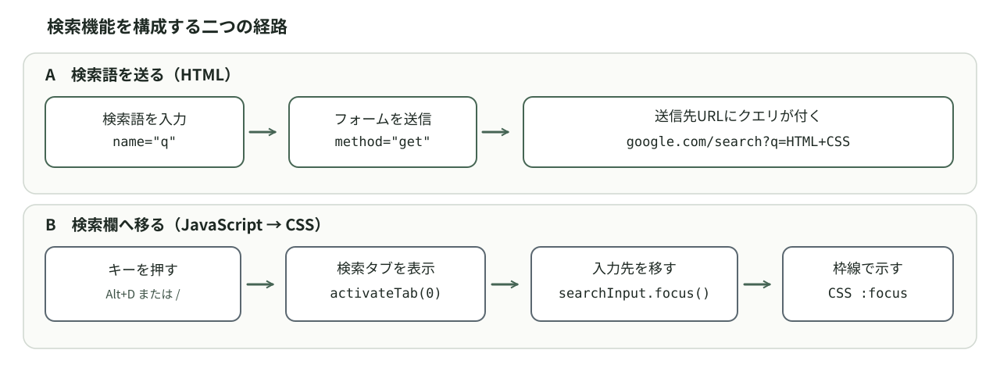

<!-- chapter-id: 05 -->
<!-- goal: HTMLフォームのGET送信とJavaScriptのフォーカス処理を分けて説明し、検索操作を検証できる -->
# 第5章　検索機能を実装する

## 5.1 知る：タブで選べる画面を、使える検索画面にする

本章では検索フォームを読み解きます。検索語の送信はHTML、検索タブへ戻って検索欄に移動する処理はJavaScript、入力欄の外観はCSSが担当します。この分担を実際のコードで確かめましょう。


## 5.2 知る：検索クエリとフォーカスは別のもの

**検索クエリ**とは検索条件として渡す文字列です。`HTML CSS`を入力して送信すると、その文字列が検索サービスに渡されます。

一方、**フォーカス**は、現在どの要素がキーボード入力などを受け取る対象になっているかを表す状態です。入力欄にフォーカスがあれば、利用者は改めて欄をクリックしなくても文字を入力できます。「検索欄を表示すること」と「検索欄にフォーカスを移すこと」は、似ていますが同じではありません。

これを踏まえて、検索に関わる処理を見てみます。



*図 V-05-001：検索語を送信するHTMLの経路（上）と、検索欄へ移動するJavaScriptの経路（下）。CSSはフォーカスされた入力欄の見た目を担当する。*

フォーム送信はHTMLとブラウザの機能です。`/`キーで検索欄へ移る動作だけはJavaScriptで追加しています。

## 5.3 読み解く：三つのファイルと画面の対応を把握する

今回の教材は、`05-search/index.html`、`05-search/style.css`、`05-search/app.js`の三つを同じフォルダーに置く構成です。添付された実際のHTMLの`<head>`には、次の読み込み指定があります。

<!-- source: chapters/new-tab-8chapters/05-search/index.html#L3-L9 -->
```html
<link rel="stylesheet" href="style.css">
<script src="app.js" defer></script>
```

`app.js`は第4章のタブ切り替えを引き継ぎ、検索欄へフォーカスする処理を加えています。

表示上の主な対応は次のとおりです。

| 画面上の部分 | HTMLの要素 | CSSの主な指定 | JavaScriptとの関係 |
| --- | --- | --- | --- |
| 「1 検索」タブ | `#tab-search` | `.filetab` | `activateTab(0)`で選択する |
| 検索パネル | `#panel-search` | `.panel`、`[hidden]` | 選択したときに表示する |
| 検索語の入力欄 | `#search-input` | `.search-input`、`.search-input:focus` | `searchInput.focus()`でフォーカスする |
| 「検索」ボタン | `button[type="submit"]` | `.search-button` | HTMLフォームの送信を行う |

次節からは、この全体像のうち、検索フォームそのもの、見た目、JavaScriptによる操作の順に調べていきます。

## 5.4 読み解く：検索語を送信するHTMLフォーム

`index.html`の検索パネルからフォームの部分を抜粋します。

<!-- source: chapters/new-tab-8chapters/05-search/index.html#L24-L32 -->
```html
<section id="panel-search" class="panel" role="tabpanel" aria-labelledby="tab-search">
  <!-- 検索はJavaScriptなしでもフォームのGET送信で動作します -->
  <form class="search-form" action="https://www.google.com/search" method="get" role="search">
    <label class="sr-only" for="search-input">検索キーワード</label>
    <input class="search-input" id="search-input" name="q" type="search"
      placeholder="Googleで検索" autocomplete="off" enterkeyhint="search" required>
    <button class="search-button" type="submit">検索</button>
  </form>
</section>
```

**`form`**は、入力された値をまとめて送信するためのHTMLの仕組みです。ここでは、入力欄と送信ボタンをひとつの`form`で囲んでいます。`role="search"`は、これが検索に使う領域であることを支援技術に伝えるための指定です。

フォームを理解するときに、最初に見るのは次の三つです。

| 記述 | この教材での値 | 担当すること |
| --- | --- | --- |
| `action` | `https://www.google.com/search` | フォームの送信先URLを指定する |
| `method` | `get` | 入力値をURLのクエリ部分に付けて送信する |
| 入力欄の`name` | `q` | 送信される項目名を決める |

たとえば`HTML CSS`と入力して送信した場合、ブラウザは概ね次の形式のURLを使います。

```text
https://www.google.com/search?q=HTML+CSS
```

URLの`?`以降が**クエリ文字列**です。`q`が項目名、`HTML+CSS`が値で、`+`は空白を表します。`q`は検索先に合わせた名前で、HTMLの固定ルールではありません。

HTMLのフォームはクリックやEnterキーで送信できます。検索語を送るための独自JavaScriptは不要です。秘密情報の送信には使わないでください。

## 5.5 読み解く：入力欄・ラベル・送信ボタンが持つ意味

`type="search"`は検索入力欄、`placeholder`は未入力時のヒントです。`placeholder`は正式なラベルの代わりにはなりません。

そこで、この教材には次のラベルがあります。

```html
<label class="sr-only" for="search-input">検索キーワード</label>
```

`for="search-input"`と`id="search-input"`でラベルを入力欄に結び付けます。`.sr-only`はラベルを視覚的に隠しつつ、支援技術から使えるようにします。

`required`は入力必須、`autocomplete="off"`は自動補完を控えるヒント、`enterkeyhint="search"`は仮想キーボードの表示用ヒントです。

最後の`<button type="submit">検索</button>`は、フォームを送信するボタンです。`type="submit"`はボタンの役割をHTMLで明示します。ここでもJavaScriptでクリックイベントを登録する必要はありません。第4章のタブボタンに付いていた`type="button"`とは、目的の違う指定です。


## 5.7 読み解く：`app.js`に加わった検索欄の取得とフォーカス

第4章ではJavaScriptを`tabs.js`から読み込んでいましたが、本章のHTMLが読み込むのは`app.js`です。`app.js`には前章のタブ切り替え処理が引き継がれ、検索欄の取得とショートカット処理が追加されています。

冒頭の要素取得を確認します。実際のコードのうち、タブと検索欄を取得する部分です。

<!-- source: chapters/new-tab-8chapters/05-search/app.js#L1-L4 -->
```javascript
const tabs = [...document.querySelectorAll('[role="tab"]')];
const panels = tabs.map(tab => document.getElementById(tab.getAttribute('aria-controls')));
const searchInput = document.getElementById('search-input');
```

`searchInput`は`id="search-input"`の要素です。`getElementById`で取得するため、HTML側の`id`を変えたらJavaScript側も合わせます。

検索欄へ移る処理の中心は、次の二行です。これは後述のイベント処理から抜粋したものです。

<!-- source: chapters/new-tab-8chapters/05-search/app.js#L29-L30 -->
```javascript
activateTab(0);
searchInput.focus();
```

`activateTab(0)`で検索パネルを表示してから、`searchInput.focus()`で入力欄へ移動します。**表示してからフォーカスする順序**が重要です。

ここで新しい検索実行関数は定義されていません。`app.js`には`form.addEventListener('submit', ...)`や`fetch()`による検索送信もありません。フォームの送信がHTMLに任されていることを思い出してください。

## 5.8 読み解く：`Alt+D`と`/`をどのように受け取るか

次は、`app.js`のキー操作を受け取る部分の抜粋です。

<!-- source: chapters/new-tab-8chapters/05-search/app.js#L19-L37 -->
```javascript
window.addEventListener('keydown', event => {
  if (event.defaultPrevented || event.isComposing || event.ctrlKey
    || event.metaKey || event.shiftKey) return;
  if (event.altKey && (event.key === '1' || event.key === '2')) {
    const index = Number(event.key) - 1;
    if (index < tabs.length) {
      event.preventDefault();
      activateTab(index);
    }
  } else if (event.altKey && event.key.toLowerCase() === 'd') {
    event.preventDefault();
    activateTab(0);
    searchInput.focus();
  } else if (!event.altKey && event.key === '/' &&
    !event.target.closest('input, textarea, select, [contenteditable="true"]')) {
    event.preventDefault();
    activateTab(0);
    searchInput.focus();
  }
});
```

`window.addEventListener('keydown', ...)`は、キーが押されたときに実行する処理を登録しています。`event`には押されたキーや、Altキーなどの同時押しの情報が入ります。処理を上から一行ずつ暗記するより、**どの条件に当てはまると、どの処理が実行されるか**を先に見ましょう。

| 操作と条件 | 実行する処理 | 期待する結果 |
| --- | --- | --- |
| Alt+1、Alt+2 | `activateTab(index)` | 検索・ニュースのタブを切り替える |
| Alt+D | `activateTab(0)`、`searchInput.focus()` | 検索パネルを開いて検索欄へ移る |
| 入力欄など以外で`/` | 同じ二つの処理 | 検索欄へ移る |
| 入力欄などで`/` | このショートカット処理を行わない | `/`を通常の入力として使える |

最初の`if`は、すでに別の処理が既定の動作を取り消したイベント（`defaultPrevented`）、日本語入力などの変換中を表すイベント（`isComposing`）、Ctrl・Meta・Shiftのいずれかを押している場合を除外します。ショートカットを無条件に発動させないための判定です。`Alt+D`の比較では、`event.key.toLowerCase()`で大文字と小文字の違いを吸収しています。

`/`の条件は、もう少し丁寧に読みます。

```javascript
!event.target.closest('input, textarea, select, [contenteditable="true"]')
```

`event.target`は、今回のキー入力イベントが発生した対象です。`closest(...)`は、対象の要素自身とその親要素を調べ、指定したCSSセレクターに一致するものを探します。ここでは、入力欄（`input`）、複数行の入力欄（`textarea`）、選択欄（`select`）、編集可能な領域（`[contenteditable="true"]`）を対象にしています。

入力中は`/`を文字として使えるよう、`closest(...)`で編集可能な要素を確認します。対象外なら検索欄へフォーカスします。

`event.preventDefault()`は、取り消し可能なキー入力イベントに対してブラウザの既定の動作を抑えるための処理です。

## 5.9 試す：フォームの送信とフォーカスを別々に検証する

以下の作業に入る前に、`index.html`、`style.css`、`app.js`が同じフォルダーにあり、HTMLから読み込めているかを確認してください。

`HTML CSS`を入力し、クリックとEnterの両方で送信します。URLの`q`を確認しましょう。検索結果が出なくても、フォームによるURL生成とは分けて考えます。

外部のページへ移動せずにフォームの入力値だけを確かめたい場合は、検索語を入力した状態でConsoleに次のコードを入力します。以下は**検証用**であり、`app.js`に追加するコードではありません。

```javascript
new FormData(document.querySelector('.search-form')).get('q')
// "HTML CSS"（入力した値に応じて変わる）
```

続いて、検索欄を空にして次の式を試します。

```javascript
document.querySelector('.search-form').checkValidity()
// false（requiredがあり、入力が空の場合）
```

これはHTMLの入力チェックを確認するための操作です。検索ボタンを押しても、入力が空ならブラウザが送信を止めることも確かめましょう。

次に、ニュースタブをクリックしてから`/`を押します。検索パネルが表示され、検索欄へフォーカスが移るかを確認してください。Consoleでは、次のように現在のフォーカス先を確かめられます。

```javascript
document.activeElement.id
// "search-input"（検索欄にフォーカスがある場合）
```

`document.activeElement`でフォーカス先を確認します。検索欄では`/`が文字として入力されることも試しましょう。Alt+Dはブラウザが優先する場合があります。

## 5.10 試す：一か所を変え、予測して、元に戻す

### 実験1：`required`を取り外す

空欄で`checkValidity()`が`false`になることを確認し、`required`だけ外して再実行します。変化を記録し、最後に`required`を戻してください。

この実験では、入力欄の見た目やJavaScriptのショートカットを変えなくても、HTMLの属性だけで入力チェックを変えられることがわかります。

### 実験2：送信する項目名を変える

変更前に、検索欄へ`HTML CSS`と入力して`new FormData(document.querySelector('.search-form')).get('q')`の結果を確認します。変更後の結果を予測してから、`index.html`の`name="q"`を**`name="keyword"`だけ**に変更してください。再読み込みして同じ語を入力し、Consoleで次を試します。

```javascript
new FormData(document.querySelector('.search-form')).get('keyword')
// "HTML CSS"（入力した値に応じて変わる）

new FormData(document.querySelector('.search-form')).get('q')
// null
```

この結果は、入力欄の`name`が送信項目の名前を決めることを示しています。この状態で送信すると、URLには`keyword=...`という項目が入るため、元の`q=...`とは異なる要求になります。Google側でどう解釈されるかまでは、HTMLの仕様だけでは保証されません。

### 実験3：JavaScriptなしでも送信できるか

変更前に`/`で検索欄へ移動できることと、検索ボタンで送信できることを確かめます。次に`index.html`のscript要素の読み込み指定という一行だけ選択後`ctrl + /`で一時的にHTMLコメントにします。

```html
<!-- <script src="app.js" defer></script> -->
```

再読み込みして、タブのクリックや`/`による切り替えができなくなることを確かめます。そのうえで、初めから表示されている検索欄へ文字を入力し、検索ボタンやEnterキーによる送信を試してください。**送信はフォームの機能なので、JavaScriptを読み込まなくても基本的に動作します**。

## 5.11 考える：操作を便利にするときの設計判断

Webアプリを作るとき、すべてをJavaScriptで実装する必要はありません。フォームには送信、入力欄には値の保持や入力チェック、ボタンには送信という基本的な仕組みが備わっています。その上に、検索欄へすぐ移動するショートカットを追加するのが本教材の考え方です。

`/`は入力中の文字と競合するため、`closest(...)`で判定します。Alt+Dはブラウザや日本語入力と競合することがあるので、代替操作も残しましょう。

発展課題として、生成AIに
>「フォームをすべてJavaScriptの`fetch()`で送信する案」と「HTMLフォームのままにする案」の違い
を尋ねてみてください。ただし、その提案をすぐに採用する必要はありません。
本章で使っている`action`、`method`、`name`、`required`がどこまで担当しているかを確認し、**新しいコードを追加する理由が本当にあるか**を考えることを課題とします。

## 5.12 ふりかえり

本章では、検索フォームの送信と、検索欄へ移動する処理を分けて読み解きました。`index.html`は`form`のGET送信を担当し、`app.js`はタブを開いて検索欄にフォーカスする処理を加え、`style.css`はフォームの配置やフォーカス時の外観を決めていました。

振り返りとして、次の内容を自分の言葉で説明してみてください。

1. `HTML CSS`という入力値が、`name="q"`と`method="get"`によってURLのどこに表れるか。
2. なぜ`activateTab(0)`の後に`searchInput.focus()`を呼ぶのか。
3. なぜ検索欄で入力した`/`はショートカットとして扱わないのか。
4. JavaScriptを読み込まなくても、検索フォームの送信が残るのはなぜか。

答えが曖昧なときは、該当するHTML・CSS・JavaScriptの行を見つけ、ブラウザで再確認しましょう。コードの意味を知るだけでなく、動作を根拠付きで説明できることが、今後の制作で役立ちます。
