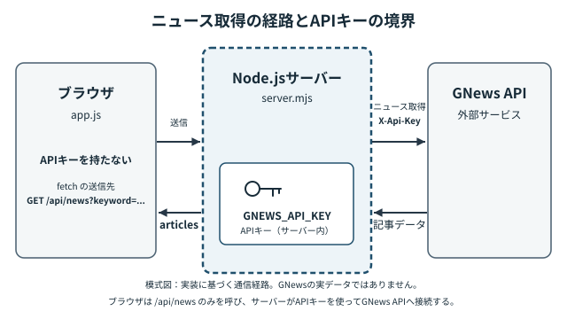

<!-- chapter-id: 06 -->
<!-- goal: ブラウザ、ローカルサーバー、外部APIの役割を分けて説明し、APIキーを公開せずに通信を検証できる -->
# 第6章　ニュースを自動取得する

## 6.1 知る：画面の中に、外部の情報を取り込む

本章では「2 ニュース」タブに外部の記事を表示します。ブラウザのJavaScript、Node.jsのローカルサーバー、GNews APIの連携を学びます。

本章の到達目標は、「何を送り、何を受け取り、画面のどの要素を書き換えているか」を説明し、成功時だけでなく失敗時も根拠を持って観察できるようになることです。
特に、**APIキーをブラウザに渡さない理由**と、**外部通信の結果をそのまま信じない理由**を考えます。

## 6.2 知る：APIと三つの担当者

**API（Application Programming Interface）**は、別のプログラムが提供する機能やデータを、決められた方法で利用するための窓口です。
GNews APIでは、検索語を指定してニュース記事のデータを取得できます。本教材では、GNewsに直接アクセスするのはブラウザではなく、自分のNode.jsサーバーです。

| 担当 | 教材のファイル・相手 | 主な仕事 |
| --- | --- | --- |
| ブラウザ | `index.html`、`style.css`、`app.js` | 操作を受け付け、自分のサーバーに依頼し、受け取った記事を画面へ表示する |
| ローカルサーバー | `server.mjs` | ブラウザからの依頼を確認し、APIキーを使ってGNewsへ問い合わせる |
| 外部サービス | GNews Search API | 検索条件に対応する記事データを返す |

ここでいう**サーバー**は、リクエスト（依頼）を受けてレスポンス（応答）を返すプログラムです。**Node.js**は、JavaScriptをブラウザの外でも実行できる環境です。同じJavaScriptでも、ブラウザで実行する`app.js`は画面を操作し、Node.jsで実行する`server.mjs`はHTTP通信とファイル配信を担当します。


*図 V-06-001：ニュース取得の通信経路。ブラウザは`/api/news`へ問い合わせ、ローカルサーバーが`X-Api-Key`ヘッダーを付けてGNews APIへ問い合わせます。記事データはサーバーを経由してブラウザに戻り、APIキーはブラウザへ返しません。*

この構造を採るのは、秘密にすべきAPIキーを、ブラウザから取得できるHTMLやJavaScriptに書き込まないためです。ブラウザ用のコードは利用者が開発者ツールで読むことができます。サーバー側でキーを管理すれば、本教材の通常の応答にキーを含めずに外部APIを利用できます。

## 6.3 知る：なぜ`index.html`を直接開かないのか

第4章と第5章は、HTMLファイルをブラウザで直接開いて動きを観察できました。しかし本章の`app.js`は、次のようなURLへアクセスします。

```javascript
fetch('/api/news?keyword=' + encodeURIComponent('テクノロジー'));
```

先頭が`/`のURLは、今開いているページと同じオリジン（通信先のスキーム・ホスト・ポートの組み合わせ）を基準にしたパスです。この教材を`http://127.0.0.1:3000/`から開いていれば、問い合わせ先は`http://127.0.0.1:3000/api/news?...`になります。一方、`file://`で`index.html`を直接開いても、`/api/news`に応答するNode.jsサーバーは起動しません。

そこで本章では、Node.jsサーバーを先に起動し、ブラウザからそのサーバーへ接続します。画面の表示に使うHTML・CSS・JavaScriptも、同じサーバーから配信される構成です。今後、通信の不具合を調べるときは、まず「どのURLからページを開いたか」を確認してください。

## 6.4 読み解く：HTMLとCSSはニュースの表示場所を用意する

`index.html`では、ニュースタブに対応するパネルが次のように定義されています。ここでは関係のある部分だけを抜粋しています。

```html
<section id="panel-news" class="panel" role="tabpanel" aria-labelledby="tab-news" hidden>
  <div class="news-card">
    <div class="news-heading">
      <h2 id="news-title">ニュース</h2>
    </div>
    <p id="news-genre" class="news-genre">ニュースタブを開くと、ニュースを取得します。</p>
    <div id="news" aria-live="polite"></div>
  </div>
</section>
```

`panel-news`は切り替え対象、`news-genre`は取得状況、`news`は記事一覧です。`aria-live="polite"`は内容の変化を支援技術に知らせます。

CSSは記事の配置と外観を担当します。たとえば、教材には次の指定があります。

```css
.news-item { display: flex; gap: 12px; padding: 12px 0; border-top: 1px solid var(--border); }
.news-image { width: 120px; height: 80px; flex: 0 0 120px; object-fit: cover; border-radius: 8px; }
.news-content { min-width: 0; }
.error { color: var(--error); }
```

`.news-item`が記事内の画像と文章を横並びにし、`.news-image`が画像の大きさをそろえます。`.error`は失敗時の文字色です。**記事をどこに作るかはHTMLとJavaScript、作られた記事をどう見せるかはCSS**という役割分担は、前章までと同じです。

## 6.5 読み解く：ニュースタブを初めて開いたときだけ取得する

まずブラウザ側の`app.js`を、大きな単位で読みます。第4・5章のタブ切り替えと検索欄へのフォーカス処理は残り、ニュース取得に必要な要素と状態が追加されました。

<!-- source: chapters/new-tab-8chapters/06-news/app.js#L1-L22 -->
```javascript
const newsBox = document.getElementById('news');
const genreBox = document.getElementById('news-genre');
let newsStarted = false;
```

`newsBox`と`genreBox`はHTML要素の参照、`newsStarted`は取得開始済みかを記録する値です。後で書き換えるため`let`を使います。

`activateTab`には、次の処理が追加されています。

```javascript
if (index === 1 && !newsStarted) {
  newsStarted = true;
  loadNews();
}
```

ニュースタブ（`index === 1`）を初めて開いたときだけ`newsStarted`を`true`にし、`loadNews()`を呼びます。

このように、画面を開いたときではなく必要になったときに処理を始める方法は、初期表示で不要な通信を避けるための一つの設計です。

## 6.6 読み解く：`fetch`と`async/await`で応答を待つ

ニュースを取得する中心は`loadNews`です。次は教材の実際のコードです。

<!-- source: chapters/new-tab-8chapters/06-news/app.js#L72-L86 -->
```javascript
async function loadNews() {
  newsBox.textContent = 'ニュースを取得しています…';
  genreBox.textContent = '取得中';
  try {
    const response = await fetch('/api/news?keyword=' + encodeURIComponent('テクノロジー'));
    const data = await response.json();
    if (!response.ok) throw new Error(data.error || `HTTP ${response.status}`);
    genreBox.textContent = `ジャンル：${data.genre}`;
    displayNews(data.articles);
  } catch (error) {
    genreBox.textContent = 'ニュースを取得できません';
    newsBox.textContent = error.message;
    newsBox.classList.add('error');
  }
}
```

`fetch`はHTTPで通信し、応答を非同期に受け取ります。`async`関数内の`await`で結果を待てます。

最初の2行で「取得しています…」「取得中」と表示するのは、利用者に通信中であることを知らせるためです。その後、`await fetch(...)`でサーバーへ依頼し、`await response.json()`で応答本文をJavaScriptのデータとして読み取ります。**JSON**は、文字列・数値・配列などを組み合わせてデータを表す形式で、サーバーとブラウザ間などプログラム同士のデータの受け渡しによく利用されます。

`encodeURIComponent`は文字列をURL用に変換します。`fetch`は404などでも自動的には例外を投げないため、`response.ok`を確認し、失敗時は`throw`と`catch`で表示を切り替えます。

成功した場合は`data.genre`を表示し、`data.articles`を`displayNews`に渡します。ここで大切なのは、**通信してデータを受け取る処理**と、**画面の要素を組み立てる処理**を別の関数にしていることです。表示方法を変えたいとき、まず`displayNews`を探せます。

## 6.7 読み解く：サーバーがAPIキーを読み込み、問い合わせを制限する

サーバー側の`server.mjs`は、ブラウザとは別のNode.jsプロセスで実行します。まず、通信先の設定とAPIキーの管理を見ます。

<!-- source: chapters/new-tab-8chapters/06-news/server.mjs#L1-L19 -->
```javascript
// 第6章：APIキーはサーバー側の環境変数から読み込み、ブラウザへ返さない。
// 起動: node --env-file=.env server.mjs （Node.js 20.6以上）
import { createServer } from 'node:http';
import { readFile } from 'node:fs/promises';
import { fileURLToPath } from 'node:url';
import { dirname, join } from 'node:path';

const folder = dirname(fileURLToPath(import.meta.url));
const port = Number(process.env.PORT ?? '3000');
const apiKey = process.env.GNEWS_API_KEY?.trim();
const keywords = new Set(['テクノロジー', 'AI', '経済', '政治', '科学']);
const ttlMs = 5 * 60 * 1000;
const cache = new Map();
```

`process.env`は、Node.jsで環境変数を参照する仕組みです。環境変数を使うと、APIキーなどの設定値をソースコードに直接書かず、実行時に渡せます。本教材では`.env`を`--env-file`で読み込み、`GNEWS_API_KEY`を取得します。`.env.example`は書式の見本であり、秘密のキーを書き込んで共有してはいけません。
`keywords`は受け付ける検索語の集合です。`Set`の`has`で登録済みかを調べ、外部APIに送る入力を限定しています。

## 6.8 読み解く：ブラウザの依頼からGNewsへのリクエストまで

`server.mjs`の`news`関数は、まず依頼された検索語を読み、値を確認します。以下は実コードの抜粋です。

```javascript
const keyword = reqUrl.searchParams.get('keyword') || 'テクノロジー';
if (!keywords.has(keyword)) return json(res, 400, { error: '未対応のジャンルです。' });
if (!apiKey) return json(res, 503, { error: 'GNEWS_API_KEY が未設定です。.env を確認してください。' });
```

許可外の`keyword`には**400**、APIキー未設定には**503**を返します。数字の意味はHTTPで定義されますが、どの場合に返すかは教材サーバーの実装です。

検査を通ると、GNewsへの問い合わせ内容を組み立てます。

```javascript
const params = new URLSearchParams({ q: keyword, lang: 'ja', country: 'jp', max: '5' });
try {
  // APIキーをクエリ文字列に含めず、ヘッダーで渡す。
  const response = await fetch(`https://gnews.io/api/v4/search?${params}`, {
    headers: { 'X-Api-Key': apiKey },
    signal: AbortSignal.timeout(9000),
  });
```

`URLSearchParams`は、`q`、`lang`、`country`、`max`などのパラメーターをURL用に組み立てます。`q`は検索語、`lang: 'ja'`は日本語の記事の指定、`country: 'jp'`は掲載国に関する指定、`max: '5'`は取得件数の上限として要求する値です。実際に返る記事の件数や内容は、GNewsに依存します。

`X-Api-Key`ヘッダーでGNewsへキーを渡し、URLへの記載を避けています。`AbortSignal.timeout(9000)`は約9秒で通信を中断します。

GNewsが正常に応答すると、サーバーは`data.articles`が配列であることを確認し、記事から`title`、`description`、`url`、`image`、`publishedAt`、`source.name`などを取り出してブラウザへ返します。GNewsの応答全体をそのままブラウザへ送り返すのではなく、必要な項目を選んでいます。このレスポンスにはAPIキーを含めていません。

## 6.9 読み解く：取得結果をニュースカードとして表示する

ブラウザに戻ってきた記事データは`displayNews`がHTML要素へ変換します。初めに`newsBox.replaceChildren()`で以前の内容を取り除き、受け取った記事を一つずつ処理します。次のコードは、記事タイトルをリンクとして作る部分の**抜粋**です。

```javascript
const link = document.createElement('a');
link.href = url;
link.target = '_blank';
link.rel = 'noopener noreferrer';
link.textContent = article.title;
content.append(link);
```

`document.createElement('a')`でリンク要素を作り、`href`に記事のURLを設定します。`target="_blank"`はリンク先を新しい閲覧コンテキストで開くため、`rel="noopener noreferrer"`は開いたページとの関係を制限するための設定です。

外部の文章は`innerHTML`ではなく`textContent`で表示します。`safeWebUrl`では`http:`／`https:`のURLのみを許可します。

記事画像は`img`で表示し、`loading = 'lazy'`で遅延読み込みします。`alt = ''`はタイトルとの重複を避ける設定です。画像がなくても記事の文字情報は表示できます。

もし有効なURLやタイトルを持つ記事が一つも表示できなければ、`newsBox`には「表示できるニュースがありません。」と表示されます。ここまでで、**JSONのデータがDOM要素になり、CSSによってニュースカードとして見える**までの道筋がつながりました。

## 6.10 考える：失敗したとき、どこで何が起こるか

通信が失敗した原因は一つとは限りません。ブラウザから見たエラーと、サーバーがGNewsから受け取ったエラーも区別する必要があります。

| 状況 | 教材サーバーの応答 | ブラウザ側での結果 |
| --- | --- | --- |
| `.env`のキーが空 | 503と設定確認のメッセージ | `catch`に進み、エラーメッセージをニュース欄へ表示 |
| 許可していない`keyword`を指定 | 400と「未対応のジャンルです。」 | `catch`に進み、エラーを表示 |
| GNewsが401・403・429などを返す | サーバーが状況に応じた文面を選び、ブラウザには502を返す | エラーを表示 |
| 通信がタイムアウトするなどして失敗 | サーバーが502と通信失敗のメッセージを返す | エラーを表示 |
| 記事として表示できるものがない | 正常な応答の内容次第 | 「表示できるニュースがありません。」と表示する場合がある |

上の「502」は、**GNewsから返ったステータスをそのまま転送した数字ではありません**。GNews側が401でも、この教材サーバーはブラウザへ502を返す構造です。開発者ツールに表示される値と元のサービスの応答を混同しないようにしてください。

また、`newsStarted`は取得開始時に`true`になり、失敗しても`false`へ戻しません。ニュースタブをいったん離れて開き直しても通信は再試行されません。改めて確認する際は、ページを再読み込みします。

## 6.11 考える：5分間のキャッシュと公開範囲

`server.mjs`では、取得した記事を`cache`という`Map`に保存します。**キャッシュ**とは、一度取得した結果を一時的に保存して、同じ依頼に再利用する仕組みです。教材の`ttlMs = 5 * 60 * 1000`は、保存結果を5分間利用する設定です。

`/api/news?keyword=テクノロジー`へ短時間に同じ依頼が来た場合、条件が合えばサーバーはGNewsに改めて問い合わせず、保存済みの記事を返します。応答JSONの`cache`が`true`なら保存結果から、`false`なら新たに取得した結果から返したことを表します。

## 6.12 試す：APIキーなしでサーバーを起動する

まず、秘密キーを用意せずに確認できる範囲から始めます。以下の操作は、元の教材ファイルを壊さずに進められます。

1. `index.html`、`style.css`、`app.js`、`server.mjs`、`.env.example`、`.gitignore`を同じフォルダーに置きます。Node.js 20.6以降が利用できることを`node --version`で確認します。
2. `.env.example`をコピーし、コピーしたファイル名を`.env`にします。**見本の「ここに新しく発行したキーを設定」という文字列は必ず消し**、次のようにキーの値を空にします。見本の文字列を残したままでは、コードは「未設定」と判定しません。

   ```dotenv
   GNEWS_API_KEY=
   PORT=3000
   ```

3. フォルダーをターミナルで開き、`node --env-file=.env server.mjs`を実行します。起動メッセージのURLを確認します。ポートが使用中などで起動しない場合は、そのエラーを先に解決します。
4. ブラウザで`http://127.0.0.1:3000/`を開き、検索タブが表示されていることを確認します。次にニュースタブを押すと、キー未設定を知らせるメッセージが表示されるはずです。
5. 開発者ツールのNetworkで`/api/news`の通信を探し、HTTPステータスとJSONの`error`を記録します。**期待するサーバーの応答は503**です。
6. 確認後、ターミナルで`Ctrl+C`を押してサーバーを止めます。`.env`は秘密情報を入れる可能性があるため、提出物や公開リポジトリへ含めないでください。

**注意：** `.env`のファイル自体が存在しない場合は、Node.jsの`--env-file`が起動時にエラーを出すことがあります。「ファイルはあるがキーが空」と「設定ファイルがない」は別の状態です。実験では前者を再現します。

## 6.13 試す：一か所だけ変え、エラーの意味を確かめる

**実験A：** キーを空にし、`http://127.0.0.1:3000/api/news?keyword=テクノロジー`で503を確認します。`keyword`だけ`未登録`にすると400になります。コードで検査順序を調べましょう。

**実験B：** `http://127.0.0.1:3000/.env`と`http://127.0.0.1:3000/server.mjs`の404を確認します。`staticFiles`を読んで理由を調べましょう。

**実験C：** `app.js`の`encodeURIComponent('テクノロジー')`を`'AI'`に変え、ブラウザを再読み込みします。Networkで`keyword=AI`を確認し、実験後に戻します。

有効なAPIキーを取得できる場合は、任意の実験として記事表示の成功も確認できます。[GNews APIの利用開始手順](https://docs.gnews.io/#__docusaurus_skipToContent_fallback)で取得方法と利用条件を確認してください。APIキーの設定は必須演習ではありません。外部通信、記事数、画像表示はネットワークや外部サービスに依存するため、キーなしでも本章の主要な学習目標を達成できます。


## 6.14 根拠を確かめる：Networkと公式資料を照らし合わせる

Networkで`/api/news`の**Request URL**・**Status**・**Response**を確認します。キー未設定なら503と`GNEWS_API_KEY`のエラーを記録しましょう。

次にGNews公式資料で、Search Endpointの`q`、`lang`、`country`、`max`の意味と、`X-Api-Key`による認証を確認します。Node.js公式資料では`--env-file`の利用方法を、MDNでは`fetch`がHTTPエラーステータスだけでは例外を投げないことを確認します。**資料に定義された動作**と、**教材で採用したエラー番号や表示文言**を分けて記録してください。

生成AIにこの通信経路を説明させた場合も、「APIキーをHTMLに直接書き込む」「ブラウザからGNewsへキーを送る」といった提案が含まれていないか、実際の`server.mjs`と公式資料で検証できます。説明の自然さよりも、コードと根拠が一致しているかを判断材料にしましょう。

## 6.15 ふりかえり：画面の外で動く処理も追えるようになる

本章では、ニュースタブの操作を起点に、ブラウザの`app.js`がローカルサーバーの`/api/news`へ依頼し、`server.mjs`がGNewsに問い合わせ、結果を`displayNews`が画面へ表示するまでを追いました。HTMLは表示場所を用意し、CSSはカードの外観を整え、ブラウザのJavaScriptは通信とDOMの更新を担当します。Node.jsサーバーはAPIキーを管理し、外部サービスとの通信を担当します。

確認してほしいのは、次の四つです。

- ニュースを開いたとき、どの関数がどの条件で呼ばれるか説明できますか。
- ブラウザとサーバーの通信先を区別し、APIキーの置き場所を説明できますか。
- `fetch`、`await`、`response.ok`、`catch`を実際の表示と結び付けられますか。
- キー未設定による503、未対応ジャンルによる400、配信対象外ファイルによる404を、Networkで確かめられますか。

これらができれば、「動いた／動かない」という結果だけでなく、**どの段階で何が起こったか**を説明できます。次章の具体的な内容は今回の資料には示されていませんが、本章で身につけた通信の経路と表示の対応を調べる方法は、今後データの種類や機能が増えても使える考え方です。
