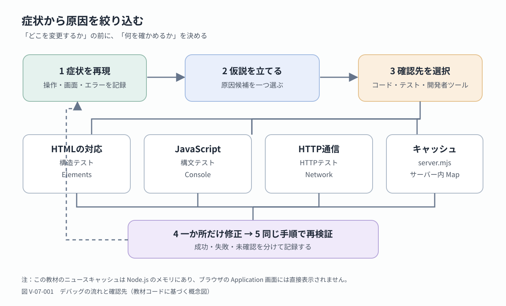

<!-- chapter-id: 07 -->
<!-- goal: エラーを症状・仮説・確認に分け、自動テストと開発者ツールを使って原因を絞り込める -->
# 第7章　エラーを見つけて修正する

## 7.1 知る：完成した機能を「確かめられる」ようにする

機能が増えると、一つの症状にも複数の原因が考えられます。本章では、問題を思いつきで直さず、**症状を再現し、仮説を立て、確かめてから、必要な部分だけを修正する**方法を学びます。原因が分からないまま複数のファイルを変えると、結果が変わった理由を追えません。これが**デバッグ**の基本です。

本章では、Node.jsの自動テストとブラウザの開発者ツールを併用します。学習の目標は次の四つです。

- HTMLの構造、JavaScriptの構文、HTTP通信のどこに問題があるかを切り分ける。
- `test.mjs`が何を検査しており、何を検査していないかを説明する。
- テストをわざと失敗させ、失敗内容から原因を読み取って復元する。
- 自動テストの結果と、ブラウザで観察した事実を区別して記録する。

大事なのは、最初からすべてのエラーを解決できることではありません。**確認できたことと、まだ確かめていないことを分けられる**ことです。

## 7.2 知る：症状、仮説、確認を分ける

デバッグの最初の一歩は、「何が起きたか」を具体的にすることです。
>ニュースが壊れた
よりも、
>ニュースタブを初めて開くと『ニュースを取得できません』と表示され、Networkには503が記録された
のほうが原因を絞り込めます。

調査は、おおむね次の順番で進めます。



*図 V-07-001：デバッグの基本的な流れと、問題の種類に応じた確認先。キャッシュは本教材ではサーバー内の`Map`に保持され、ブラウザのApplication画面へ自動的に保存されるわけではありません。*

どこを調べるか迷ったときは、次の対応を手掛かりにします。

| 目に見える症状 | 最初に疑う場所 | 主な確認方法 |
|---|---|---|
| タブとパネルが対応しない | `index.html`の`id`と`aria-controls` | 構造テスト、Elements |
| JavaScriptが実行できない | `app.js`や`server.mjs`の文法 | `node --check`、テスト、Console |
| ニュースを取得できない | `/api/news`の応答やサーバー設定 | Network、HTTPテスト、サーバー側コード |
| 一度取得したニュースが再利用される | サーバー内のキャッシュ | `server.mjs`の`cache`と時間判定、応答の`cache`値 |

これらは調査の入口であって、原因を断定する表ではありません。たとえば、画面が切り替わらない場合にはHTMLの対応の誤りだけでなく、JavaScriptの例外も考えられます。

## 7.3 読み解く：今回使用するファイルと自動テスト

`test.mjs`はNode.jsで動くテスト用ファイルです。`.mjs`はECMAScriptモジュールとして扱う拡張子で、ブラウザ画面を作るものではありません。

テストを実行するには、少なくとも次のファイルが同じ`07-debug`フォルダーに必要です。

```text
07-debug/
├─ index.html       ← HTMLのタブ・パネルを検査
├─ app.js           ← 構文を検査
├─ style.css        ← ブラウザでの表示に使用
├─ server.mjs       ← 構文とHTTP応答を検査
└─ test.mjs         ← 今回読む自動テスト
```

`index.html`と`app.js`は第6章で使ったものを引き継ぎます。

```bash
node --test test.mjs
```

`--test`はNode.jsの**テストランナー**を使用する指定です。テストランナーは、登録された確認処理を実行し、成功・失敗をまとめて表示します。教材の`test.mjs`には三つのテストがあり、それぞれが独立した役割を持っています。

| テスト名（要約） | 確認する内容 | 確認しない内容 |
|---|---|---|
| タブとパネルの対応 | 特定の`id`と`aria-controls`の個数・文字列の一致 | 実際のクリック動作、表示、重複IDの完全な検出 |
| JavaScriptの構文 | `app.js`と`server.mjs`が構文として解釈できるか | 実行時の例外や画面操作の正しさ |
| APIキー未設定時の応答 | `/`が200、`/api/news`が503、指定した秘密ファイルのパスが404 | GNewsへの実接続、APIキーを設定した場合の成功、すべてのURLの安全性 |

**テストがすべて成功したことと、Webアプリのあらゆる動作が正しいこと**は同一ではないことを留意しましょう。

## 7.4 読み解く：テストを書くための基本部品

`test.mjs`の冒頭には、次の読み込みがあります。

<!-- source: chapters/new-tab-8chapters/07-debug/test.mjs#L1-L8 -->
```javascript
import test from 'node:test';
import assert from 'node:assert/strict';
import { readFile } from 'node:fs/promises';
import { spawn, spawnSync } from 'node:child_process';
import { join, dirname } from 'node:path';
import { fileURLToPath } from 'node:url';

const folder = dirname(fileURLToPath(import.meta.url));
```

`import`で機能を読み込みます。`node:test`はテスト、`node:assert/strict`は期待値の検証、`readFile`はファイルの読み込み、`spawn`・`spawnSync`は別プログラムの起動に使います。

`folder`は`test.mjs`のあるフォルダーを指し、`index.html`などの参照先を定めます。サーバー起動時にも`cwd: folder`を指定します。

## 7.5 読み解く：HTMLの対応関係を自動で調べる

最初のテストは、タブとパネルの対応を調べます。

<!-- source: chapters/new-tab-8chapters/07-debug/test.mjs#L10-L16 -->
```javascript
test('タブ数とパネル数が一致し、aria-controlsが対応する', async () => {
  const html = await readFile(join(folder, 'index.html'), 'utf8');
  const ids = [...html.matchAll(/id="(panel-[^"]+)"/g)].map(m => m[1]);
  const controls = [...html.matchAll(/aria-controls="(panel-[^"]+)"/g)].map(m => m[1]);
  assert.equal(ids.length, controls.length);
  assert.deepEqual(ids.sort(), controls.sort());
});
```

第4章で学んだように、タブの`aria-controls="panel-news"`は、`id="panel-news"`のパネルを指します。もし名前が違えば、JavaScriptが意図するパネルを探せなくなる可能性があります。そこで、このテストはHTMLファイルを文字列として読み込み、二つの名前の集まりを比較します。

`matchAll`で正規表現に一致する`id`と`aria-controls`を集めます。`assert.equal`は件数、`assert.deepEqual`は並び替え後の値を比較します。

たとえば、ニュースタブの`aria-controls`だけを`panel-news-typo`に変更すれば、パネル側の`id`にはその名前が存在しないため、比較結果が一致しなくなります。ただし、このテストはHTMLをDOMとして解析していません。**特定の書き方を正規表現で調べる簡易テスト**です。

## 7.6 読み解く：JavaScriptの構文を確認する

二番目のテストは、JavaScriptの**構文エラー**を見つけるためのものです。構文エラーとは、括弧が閉じられていないなど、言語の書き方として解釈できない問題です。

<!-- source: chapters/new-tab-8chapters/07-debug/test.mjs#L18-L23 -->
```javascript
test('JavaScriptファイルに構文エラーがない', () => {
  for (const filename of ['app.js', 'server.mjs']) {
    const result = spawnSync(
      process.execPath,
      ['--check', join(folder, filename)],
      { encoding: 'utf8' }
    );
    assert.equal(result.status, 0, result.stderr);
  }
});
```

`for...of`でファイルを順に調べ、`spawnSync`で`node --check`を実行します。`--check`はプログラムを動かさず構文だけを検査します。

`result.status`が`0`なら、コマンドは正常終了したと判断して次へ進みます。`0`以外であれば、`assert.equal`が失敗し、エラーの詳細がテスト結果に表示されます。`result.stderr`は、コマンドがエラー内容などを書き出すための出力です。

`node --check`でわかるのは構文の誤りだけです。正しい動作は実行して別途確かめる必要があります。

## 7.7 読み解く：サーバーを起動し、HTTP応答を検査する

三番目のテストは、自分のNode.jsサーバーを一時的に起動し、実際にHTTPリクエストを送ります。HTTPは、ブラウザとサーバーが情報をやり取りするときの規則です。サーバーは処理結果を`200`や`503`などの**ステータスコード**で返します。

最初に、テストがサーバーを起動する部分を見ます。

<!-- source: chapters/new-tab-8chapters/07-debug/test.mjs#L25-L30 -->
```javascript
test('APIキー未設定ならニュースAPIは503で、秘密ファイルは配信しない', async () => {
  const child = spawn(process.execPath, ['server.mjs'], {
    cwd: folder,
    env: { ...process.env, GNEWS_API_KEY: '', PORT: '0' },
    stdio: ['ignore', 'pipe', 'pipe']
  });
  // 以下にサーバーへの確認と終了処理が続く（省略）
});
```

`spawn`でサーバーを起動します。`cwd`は作業場所、`env`はテスト用の環境変数、`PORT: '0'`はOSによる空きポートの選択です。

このテストは、通常のニュース取得が成功するかどうかを調べるものではありません。**APIキーが設定されていない場合に、サーバーが想定どおりの失敗を返すか**を確認します。`server.mjs`には次の条件があります。

<!-- source: chapters/new-tab-8chapters/07-debug/server.mjs#L26-L29 -->
```javascript
async function news(reqUrl, res) {
  const keyword = reqUrl.searchParams.get('keyword') || 'テクノロジー';
  if (!keywords.has(keyword)) return json(res, 400, { error: '未対応のジャンルです。' });
  if (!apiKey) return json(res, 503, { error: 'GNEWS_API_KEY が未設定です。.env を確認してください。' });
  // 以下は省略
}
```

この教材では、キーが空ならGNewsへ問い合わせる前に`503`を返す設計です。HTTPの一般的な意味として`503`はサービスがリクエストに対応できない状態を示しますが、**キー未設定を503で表現することは教材サーバーの実装上の判断**です。すべてのWeb APIが同じ条件で503を返すわけではありません。

テストの応答確認部分では、次の処理が実行されます。

<!-- source: chapters/new-tab-8chapters/07-debug/test.mjs#L41-L48 -->
```javascript
const html = await fetch(url);
assert.equal(html.status, 200);
const news = await fetch(url + '/api/news');
assert.equal(news.status, 503);
assert.match((await news.json()).error, /GNEWS_API_KEY/);
for (const path of ['/server.mjs', '/.env', '/.env.example']) {
  assert.equal((await fetch(url + path)).status, 404);
}
```

`fetch`で`/`の200、ニュースAPIの503、対象パスの404を確認します。`assert.match`でエラーメッセージに`GNEWS_API_KEY`が含まれるか検査します。

`server.mjs`は`staticFiles`の登録対象のみ配信します。`/.env`と`/server.mjs`の404を確認しますが、この結果だけで安全性全体は保証できません。

なお、三番目のテストの終わりでは`finally`を使い、成功・失敗にかかわらず起動したサーバープロセスに`child.kill()`を呼びます。テスト用のサーバーを起動したままにしないための処理です。`try`と`finally`は、途中でエラーがあっても後始末を実行するために使います。

## 7.8 読み解く：テストの成功・失敗を読む

テストランナーが表示する結果では、`ok`が成功、`not ok`が失敗を表します。三つのテストが成功したときは、概ね次のような表示になります。これは**表示形式を説明するための例**であり、実行時間などは環境によって異なります。

```text
TAP version 13
# Subtest: タブ数とパネル数が一致し、aria-controlsが対応する
ok 1 - タブ数とパネル数が一致し、aria-controlsが対応する
# Subtest: JavaScriptファイルに構文エラーがない
ok 2 - JavaScriptファイルに構文エラーがない
# Subtest: APIキー未設定ならニュースAPIは503で、秘密ファイルは配信しない
ok 3 - APIキー未設定ならニュースAPIは503で、秘密ファイルは配信しない
1..3
# tests 3
# pass 3
# fail 0
```

**TAP**はテスト結果の表示形式です。`pass`は成功数、`fail`は失敗数。`not ok`の項目で期待値と実際の値を比べましょう。

## 7.9 試す：意図的にHTMLを壊し、修正する

まず、自動テストが問題を見つける様子を確かめます。変更対象は一か所だけです。作業前にファイルのコピーを保存してもかまいません。

1. **変更前を確認する**：`node --test test.mjs`を実行し、三つのテストが成功することを確かめます。
2. **予測する**：ニュースタブの`aria-controls`が存在しないパネル名を指したら、何番目のテストが失敗するか記録します。
3. **一か所だけ変更する**：`index.html`の`aria-controls="panel-news"`を`aria-controls="panel-news-typo"`へ変更します。パネル側の`id="panel-news"`は変更しません。
4. **結果を確認する**：再度`node --test test.mjs`を実行し、`not ok`になったテスト名と、表示された二つの配列の違いを書き留めます。
5. **理由を説明する**：テストが「値の個数」ではなく「値の一致」で失敗した理由を、`assert.deepEqual`の行と結び付けて説明します。
6. **元に戻す**：`aria-controls="panel-news"`へ戻し、同じコマンドを実行して成功することを確かめます。

この実験では、HTMLを壊しても構文テストは成功する場合があります。テストが別々の条件を調べているからです。失敗を一つ作っただけで、三つすべてが同時に失敗するわけではない点にも注目してください。

## 7.10 試す：構文エラーと実行時の問題を区別する

次は、JavaScriptの構文検査が何を見つけるかを確かめます。ここでも変更は一か所に限定します。

1. **変更前を確認する**：`node --check app.js`を実行し、正常終了することを確かめます。
2. **予測する**：ファイルの末尾に閉じられていない括弧があったら、何が起こるかを予測します。
3. **一か所だけ変更する**：`app.js`の末尾に、次の**意図的に不完全な一行**を追加します。これは動作するコード例ではありません。

   ```javascript
   function broken( {
   ```

4. **結果を確認する**：`node --check app.js`と`node --test test.mjs`を順に実行し、`SyntaxError`などのメッセージと、失敗するテストの名前を確認します。
5. **理由を説明する**：構文として解釈できないため、タブやニュースの動作を調べる段階まで進めないことを説明します。
6. **元に戻す**：追加した一行を完全に削除し、構文検査と三つのテストが再び成功することを確認します。

構文検査が成功した場合でも、ブラウザ上の動作まで保証されません。たとえば`id`の書き間違いによる`null`の扱いは、実行したときに初めて問題になることがあります。その場合には、次節の開発者ツールを使います。

## 7.11 試す：開発者ツールのElementsとConsoleを使う

ブラウザの**開発者ツール**は、表示されているページの要素や、JavaScriptのエラー、通信内容などを確認するための道具です。Chromium系ブラウザでは主にElements、Console、Networkなどの名前で表示されます。ブラウザによって名称や配置は異なります。

**Elements**で`tab-news`と`panel-news`の`aria-selected`・`hidden`を確認します。状態が正しければ、次はCSSを調べます。

<!-- source: chapters/new-tab-8chapters/07-debug/style.css#L60-L65 -->
```css
.filetab[aria-selected="true"] {
  background: var(--surface);
  border-color: var(--border);
  color: var(--text);
}
```

この規則は、タブの選択状態を見た目に反映する部分です。選択状態が更新されない問題と、選択状態は変わるのに色が変わらない問題では、調べる場所が異なります。

**Console**では、JavaScriptのエラーメッセージを確認したり、式を入力したりできます。次の式は説明のための確認用であり、`app.js`に追加する必要はありません。

```javascript
document.querySelectorAll('[role="tab"]').length
// この教材では通常 2

document.getElementById('tab-news').getAttribute('aria-controls')
// 通常 "panel-news"

document.getElementById('panel-news') !== null
// 通常 true
```

`SyntaxError`が表示されたらコードの書き方を調べます。一方、`TypeError`のような実行中の例外が出た場合は、エラーの前後で取得した要素が存在していたか、操作する値が想定どおりかを調べます。最初に出たエラーを記録するのは、後から発生したエラーが、その影響で起きている可能性があるためです。

## 7.12 試す：Networkで通信の失敗を読み取る

ニュースの通信を調べるときはローカルサーバーを起動し、`http://127.0.0.1:3000/`を開きます。`file://`では`/api/news`を正しく試せません。

APIキー未設定時の動作を安全に確認する場合は、教材フォルダーに`.env`を用意し、少なくとも次のようにキーの値を空欄にします。実際のAPIキーを本文や実験記録に貼り付ける必要はありません。

```dotenv
GNEWS_API_KEY=
PORT=3000
```

Node.js 20.6以上の環境では、次のコマンドで起動できます。

```bash
node --env-file=.env server.mjs
```

環境変数がすでに別の場所で設定されている場合は、`.env`の値だけで上書きされるとは限らないため注意してください。キーが確実に空であることを試す自動テストでは、前述のようにテスト用プロセスの`env`を明示的に指定しています。

**Network**で`/api/news?keyword=...`の応答を確認します。キーが空なら503と`GNEWS_API_KEY`を含むエラーになり、画面は取得失敗を表示します。

503という番号だけで原因は決まりません。応答メッセージも確認しましょう。キー未設定時はGNewsへ通信せずにサーバーが応答します。

なお、教材の`app.js`には`newsStarted`という変数があり、ニュースを初めて開いたときだけ`loadNews()`を実行します。**一度エラーになっても、タブを往復するだけでは再度取得しません。** 

## 7.13 考える：キャッシュはどこに保存されているか

ニュースが前と同じ内容に見えるとき、キャッシュの影響を疑うことがあります。**キャッシュ**とは、取得や計算を繰り返さずに済むよう、以前の結果を一時的に保持する仕組みです。ただし、どこに保存するかは実装によって異なります。

本教材の`server.mjs`には、次のコードがあります。

<!-- source: chapters/new-tab-8chapters/07-debug/server.mjs#L11-L13 -->
```javascript
const ttlMs = 5 * 60 * 1000;
const cache = new Map();
```

ニュースのキャッシュはサーバーの`Map`にあり、ブラウザのApplicationでは直接見られません。`server.mjs`とNetworkの`cache`値で確認します。成功した取得がない場合は検証できません。

また、`server.mjs`のAPI応答には`Cache-Control: no-store`が設定されています。これはブラウザなどに対するHTTPキャッシュの指定であり、**サーバーのメモリ内にある`Map`とは別の仕組み**です。同じ「キャッシュ」という名前でも、場所と目的を確かめる必要があります。

## 7.14 考える：自動テストで確認できないことを見極める

自動テストは、繰り返し確かめたい条件を一定の方法で検査できる点が強みです。今回のテストは、HTMLの一部の対応、JavaScriptの構文、キー未設定時のサーバー応答という、外部サービスに頼らず確認しやすい条件を選んでいます。この範囲であれば、修正後に同じコマンドを再実行し、以前の条件が維持されているかを調べられます。

新しい機能を追加したときは、まず「何ができれば成功なのか」を具体的に書き出してみてください。自動化するかどうかは、その条件を繰り返し確認する必要があるか、結果をプログラムで判定できるかによって考えます。目で確かめたこと、テストによって判定したこと、外部条件のため未検証のことを、同じ「確認済み」とまとめないことが大切です。

## 7.15 章末演習：小さなデバッグ記録を作る

最後に、実験9または10のどちらか一方を選び、次の表を埋めてみましょう。原因を最初から知っていても、あえて「予測」と「観察」を別の欄に書きます。

| 記録する項目 | 記入例（HTMLの対応を変えた場合） |
|---|---|
| 症状 | 構造テストが`not ok`になった |
| 仮説 | `aria-controls`とパネルの`id`が一致しない |
| 変更した一か所 | `panel-news`を`panel-news-typo`にした |
| 確認方法 | `node --test test.mjs` |
| 観察した事実 | 名前の配列が一致しないと報告された |
| 修正と再検証 | 元の値へ戻し、テストの成功を確認した |

**発展課題：** `node --check app.js`が成功してもタブが動かない例を考えます。ElementsとConsoleで確かめ、変更した場合は必ず元に戻しましょう。

**発展課題：** AIの修正案について、必要な理由と確認方法を説明しましょう。変更は一度に一か所とし、動作を検証します。

## 7.16 ふりかえり：確認の結果を根拠に直す

本章では、エラーを再現し、仮説を確かめ、修正後に再検証する方法を学びました。`test.mjs`・Elements・Console・Networkは、それぞれ異なる問題を調べる道具です。

これまでの章では、機能を一つずつ作り、その動作を確かめてきました。ここで身につけたデバッグの手順は、今後新しい機能を加えるときや、制作物を見直すときにも役立ちます。**「動いたかどうか」だけでなく、「どの条件を、どの根拠で確認できたか」を説明できること**が、自分で学び続けるための土台になります。
