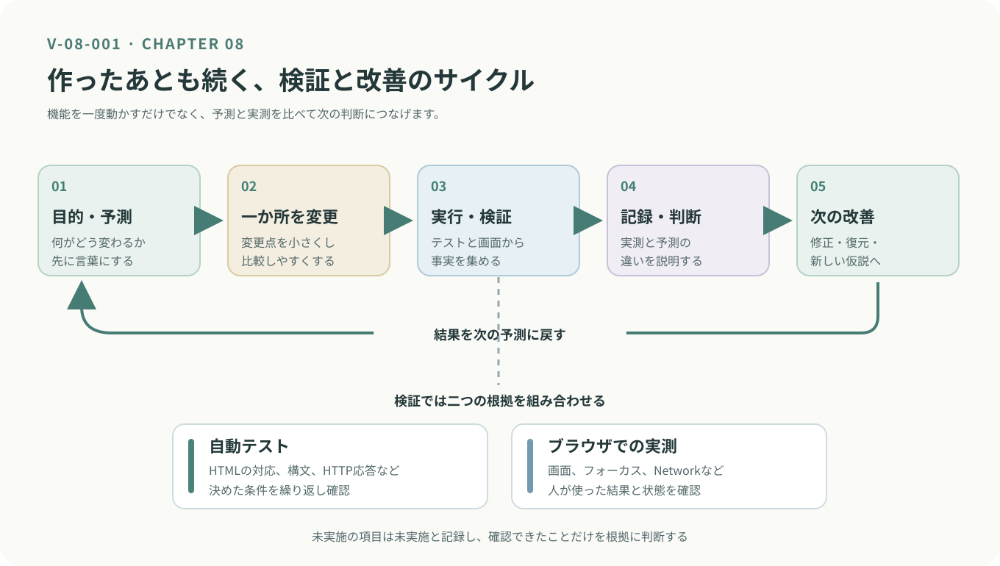

<!-- chapter-id: 08 -->
<!-- goal: 目的を持ち、仕組みを知り、試し、確かめる。 -->
# 第8章　完成・検証・拡張

## 知る：完成は、次の制作への出発点

ここまで、私たちは「New Tab」という一つのWebアプリを通して、HTMLで画面の構造を作り、CSSで見た目を整え、JavaScriptで操作を加える方法を学んできました。
はじめは別々に見えていた技術も、一つの作品の中でつながっていることが分かってきたのではないでしょうか。

では、この「New Tab」は完成したのでしょうか。

検索・タブ・ニュースの表示には、さらに改善できる点があります。

作品には、必ずしも「これで完成」という明確な終点があるわけではありません。しかし、いつまでも作り続けなければならないわけでもありません。

**何を実現できたら一区切りとするのか。その判断基準を持つことも、制作の大切な一部です。**

そこで本章では、これまでの制作を振り返り、動作を確かめ、結果を記録する方法を学びます。そして、その経験を次の作品へどうつなげるかを考えます。

本章の到達目標は、次の三つです。

1. 「New Tab」の仕組みと動作を振り返り、確認した結果を説明できる。
2. 制作の成果をREADMEや設計メモとして残せる。
3. 新しい機能や作品について、目的と確かめる方法を考えられる。

制作を終えることは、学びを終えることではありません。これまでに得た知識や発見を、次の制作でも使える形に整えていきましょう。

## 読み解く：「New Tab」を支える仕組み

まずは、完成したアプリの全体像を振り返ってみましょう。

「New Tab」では、HTML、CSS、JavaScript、Node.jsサーバーが、それぞれ異なる役割を担っています。

```text
HTML ── 画面の構造 ──┐
CSS ─── 画面の見た目 ─┼── ブラウザの画面
JavaScript ─ 操作 ───┘        │
                              │ ニュースを要求
                              ▼
                       Node.jsサーバー
                              │
                              │ 外部APIと通信
                              ▼
                           GNews API
```

*図：New Tabを構成する技術の関係（概念図）。ニュースの取得では、JavaScriptが自分のサーバーに要求を送り、サーバーがGNews APIから得た情報をブラウザへ返す。*

画面に表示されるものだけでなく、その裏側でどのような処理が行われているかも、少しずつ理解してきました。

| 仕組み | 主な役割 | 確認に使うもの |
|---|---|---|
| HTML | 検索フォーム、タブ、表示領域などを構成する | Elements |
| CSS | 色、余白、配置、フォーカス時の見た目を整える | 画面、Styles |
| JavaScript | 操作を受け取り、タブの切り替えやニュースの表示を制御する | Console、Elements、Network |
| Node.jsサーバー | ファイルの配信、APIキーの管理、外部APIとの通信を行う | 起動ログ、HTTP応答 |
| 自動テスト | あらかじめ決めた条件が満たされているかを検査する | テスト結果、エラー |

これらは、互いに独立しているわけではありません。

たとえば、タブの見た目が切り替わらないとき、原因がCSSにあるとは限りません。HTMLの属性とJavaScriptの処理が正しく対応していない可能性もあります。

だからこそ、問題が起きたときには、**画面に見えている現象と、その現象を生み出している仕組みを分けて考える**ことが大切です。

### 動作を一つずつ確かめる

作品を一区切りにする前に、今ある機能を実際に操作してみましょう。

「正しく動く」と思っている機能も、操作方法や実行環境を変えると、思いがけない結果になることがあります。

次の表を使い、確認できたことを記録してください。

| 確認対象 | 試す操作・条件 | 確かめること |
|---|---|---|
| 初期表示 | ページを開く | 検索タブとフォームが表示されるか |
| 検索 | 検索語を入力して送信する | 送信先URLと`q`の値が対応しているか |
| タブ | タブをクリックする | `aria-selected`と`hidden`が適切に変わるか |
| キーボード | Tab、左右矢印、Home、Endを試す | フォーカスと選択状態がどう変わるか |
| ショートカット | Alt+1、Alt+2、`/`を試す | 意図した操作ができるか、ブラウザなどと競合しないか |
| ニュース | ニュースタブを開く | `/api/news`への要求と表示結果が対応しているか |
| 再取得 | 再取得ボタンを押す | 新しい通信が発生するか |
| キャッシュ | 短時間で再びニュースを表示する | 保存されたデータが使われるか、通信が発生するか |
| 通信失敗 | APIキーを設定せず起動する | HTTP応答とエラー案内がどうなるか |
| 配色・画面幅 | ダークモードや狭い画面で開く | 文字やレイアウトが読みやすいか |
| 画像 | 画面外のニュース画像を観察する | 読み込みのタイミングがどう変わるか |

実際の結果は、別の欄やメモに書き加えましょう。ブラウザの開発者ツールを使えば、画面だけでは分からない属性や通信の状態も確認できます。

なお、すべての操作が、どの環境でも同じ結果になるとは限りません。

たとえば、ショートカットキーはOSやブラウザの操作と重なる場合があります。また、画像の遅延読み込みは、ブラウザの判断によって読み込みのタイミングが変わります。

重要なのは、予想どおりに動いたかどうかだけではありません。**どの条件で、何が起きたのかを確かめること**です。

## 考える：次にタブを増やすなら

現在の「New Tab」に、もう一つタブを追加するとしたら、どのような機能が欲しいでしょうか。

たとえば、制作中に思いついたことを残せる「メモ」タブがあると便利かもしれません。

ただし、すぐにコードを書き始める必要はありません。まずは、何を作りたいのかを言葉にしてみましょう。

### 小さな設計メモを作る

次の表は、「メモ」タブを追加する場合の設計例です。

| 考えること | 設計メモの例 |
|---|---|
| 追加する機能 | 短い文章を入力し、保存したメモを表示する |
| 入力するもの | メモの文章 |
| 保存する場所 | ブラウザの`localStorage`を利用する案を検討する |
| 変更するファイル | タブを定義するHTML、見た目を指定するCSS、操作を処理するJavaScript |
| 確かめる方法 | タブ切り替え、保存、再表示、キーボード操作を確認する |

`localStorage`は、ブラウザ側にデータを保存するための仕組みの一つです。ページを開き直してもデータを利用できるため、簡単なメモ機能の候補になります。ただし、保存先のブラウザやサイトの条件に依存するため、どこでも同じメモを利用できるわけではありません。

ここでは、保存機能を完成させることが目的ではありません。何が必要で、どこを変更し、どう確認するのかを考えることが目的です。

### 既存の仕組みとのつながりを考える

タブを追加するときには、見た目だけでなく、HTMLとJavaScriptの関係も考える必要があります。

HTMLでは、新しいタブの`id`と`aria-controls`、対応するパネルの`id`と`aria-labelledby`が、正しい要素を指すようにします。

JavaScriptでは、タブを管理する処理が三つ目のタブにも対応できるかを調べます。たとえば、数字のショートカットが二つのタブだけを想定していないか、確認が必要です。

さらに、キーボード操作や自動テストも、新しいタブを含めて確かめられるようにします。

ここで作る成果物は、完成したコードではなくても構いません。

**「追加する機能」「変更するファイル」「確かめる方法」**の三つを説明できる設計メモを残してください。

変更するファイル名は、実際の「New Tab」の構成を調べて記入しましょう。

生成AIに実装案を提案してもらう場合も、この設計メモが判断の基準になります。提案されたコードに、実際には存在しない関数や属性が含まれていないかを確かめ、採用するかどうかを決めましょう。

## 根拠を確かめる：予測と実測を分けて記録する

制作中には、「なぜ動かなかったのだろう」「この変更で本当に直ったのだろう」と考える場面があります。

そんなときに役立つのが、予測と実測を分けて記録する方法です。

確認の記録は、次の五つを一組にすると、後から読み返しやすくなります。

| 記録すること | 書く内容 |
|---|---|
| ① 対象と条件 | 何を、どの環境で、どう操作したか |
| ② 予測 | 操作する前に何が起きると思ったか |
| ③ 実測 | 画面、属性、通信、テスト結果など、実際に確認した事実 |
| ④ 判断 | 予測と実測は一致したか。どの資料やコードが根拠になるか |
| ⑤ 次の行動 | 修正するか、元に戻すか、別の条件で試すか |

たとえば、ニュースの再取得に失敗した場面を考えてみましょう。

単に「ニュースが表示されなかった」と書くだけでは、後から原因を調べることが難しくなります。

一方、APIキーを設定せずに起動した場合の動作を調べ、実際にHTTPステータス503が返されたのであれば、次のように記録できます。

> **条件：** APIキーを設定せずサーバーを起動し、再取得ボタンを押した。
>
> **予測：** ニュースを取得できず、エラー案内が表示される。
>
> **実測：** Networkで`/api/news`への要求と503応答を確認し、画面にエラー案内が表示された。
>
> **判断：** APIキー未設定時のサーバー処理と、ブラウザ側の表示処理を照合する。
>
> **次の行動：** APIキーを正しく設定した状態で、もう一度確認する。

※これは記録方法の例です。503という応答が返るかどうかは実際のサーバー実装によります。記録には、自分で観察した値を書いてください。

このように記録しておけば、何を確認し、何を根拠に判断したのかが明確になります。

自動テストは、決めた条件を繰り返し検査するときに役立ちます。一方、画面の読みやすさや実際の操作感は、ブラウザを使って確かめる必要があります。

どちらか一方だけでなく、両方を組み合わせることが大切です。



*図 V-08-001：検証サイクル。目的を決め、小さく変更し、結果を確かめて記録する。その繰り返しが、次の改善につながる。*

思いどおりに動かなかったことも、大切な結果です。

失敗を隠すのではなく、「どこまで確かめられたか」「何がまだ分からないか」を書き残しましょう。その記録は、次に問題と向き合うときの手掛かりになります。

## 残す：未来の自分に作品を引き継ぐ

ここまでで、アプリの構造を振り返り、動作を確かめ、結果を記録しました。

では、しばらく時間が経ってから、もう一度「New Tab」を開く場面を想像してみましょう。

起動するために必要なコマンドは何だったでしょうか。APIキーはどこで設定したでしょうか。まだ直していない問題はあったでしょうか。

制作した直後には覚えていることも、時間が経つと忘れてしまいます。

そこで役立つのが、作品の説明書となる`README.md`です。

### README.md：作品の説明書を作る

`README.md`は、作品の概要や使い方などを記録するテキストファイルです。

Markdownという書き方を使えば、`#`で見出しを付けたり、箇条書きで情報を整理したりできます。

「New Tab」のフォルダーにもREADMEを作り、まずは次のような情報をまとめてみましょう。

```markdown
# New Tab

## 作品の概要
検索とニュースの閲覧ができるWebアプリです。

## 主な機能
- キーワードを入力して検索する
- タブで表示内容を切り替える
- ニュースを取得して表示する

## 起動方法
1. 必要な実行環境を準備する
2. APIキーを所定の方法で設定する
3. ［確認した起動コマンド］を実行する
4. ［確認したURL］をブラウザで開く

## 動作確認
- ［確認したテストコマンド］
- ［確認したブラウザと環境］

## 今後の改善
- ［追加したい機能］
- ［まだ確認できていないこと］
```

これは書き方の一例です。角かっこで示した部分は、実際に使ったコマンドや確認した内容に書き換えてください。

READMEには、実際に試していない操作や、存在しないファイル名を書かないようにしましょう。

また、APIキーなどの秘密情報は記載せず、設定方法だけを説明します。

最初から立派な説明書を作る必要はありません。まずは、**数週間後の自分が迷わず作品を起動できること**を目標にしてください。

### 読みやすいコードも記録の一つ

読みやすさは、READMEだけでなく、コードの中でも大切です。

たとえば、ニュース記事の一覧を表す変数なら、`data`という名前よりも、`newsArticles`のように役割が分かる名前のほうが、後から処理を理解しやすくなります。

これは命名の例であり、「New Tab」の完成版に同名の変数があるという意味ではありません。

コメントを書くときも、処理をそのまま言い換えるだけでなく、「なぜこの処理が必要なのか」を補足すると役立ちます。

ただし、説明と実際の動作が食い違っていては、かえって混乱を招きます。コードを変更したときには、コメントやREADMEも見直しましょう。

分かりやすい記録を残すことは、未来の自分を助けることでもあります。

## 広げる：次の制作に向けて

「New Tab」で学んだのは、一つのアプリの作り方だけではありません。

目的を考え、仕組みを調べ、コードを読み、小さく変更し、結果を確かめる。この進め方は、これから制作する別の作品にも応用できます。

ここからは、その経験をどう広げていくかを考えましょう。

### アイデアは、身近な気付きから生まれる

新しい作品のきっかけは、日常の小さな不便や興味の中にあります。

「授業の予定を、もっと簡単に確認したい」

「好きな分野のニュースだけをまとめて読みたい」

「制作中に見つけた参考資料を、忘れずに整理したい」

こうした気付きが、次の制作の出発点になります。

思いついたことは、実現方法が分からなくても、まずメモに残してみてください。

そのときに考えたいのは、**「誰が、どのような場面で、何をできるようにしたいのか」**ということです。

たとえば、「授業の予定を表示するアプリ」を作るなら、最初から多くの機能を考える必要はありません。

まずは今日の予定を一件表示する。その次に、複数の予定を表示する。必要になったら、日付による切り替えを追加する。

このように、小さな目標から始めれば、作りながら必要な知識を増やしていけます。

設計メモは、その最初の一歩になります。

### GitHubやCodePenから学ぶ

自分で作るだけでなく、ほかの人がどのように制作しているかを観察することも、学習の助けになります。

[GitHub](https://github.com/)は、ソースコードや変更履歴を管理・共有できるサービスです。公開された作品のファイル構成を調べたり、自分の制作過程を残したりするときに役立ちます。

[CodePen](https://codepen.io/)では、HTML、CSS、JavaScriptを編集し、その結果を画面で確認できます。小さな表現や操作を試したいときに便利です。ただし、Node.jsサーバーを含む「New Tab」全体が、そのまま動くわけではありません。

参考になる作品を見つけたら、コードをすぐにコピーするのではなく、まず動きを観察してみましょう。

どのような目的で作られているのか。どの部分が使いやすいのか。自分の作品に取り入れるとしたら、何を変える必要があるのか。

そう考えることで、単なる模倣ではなく、自分の目的に合わせた工夫につながります。

なお、公開されているコードや画像であっても、自由に再利用できるとは限りません。利用条件やライセンスを確認し、参考にした資料を記録しておきましょう。

自分の作品を公開するときも、APIキーなどの秘密情報が含まれていないかを確認してください。

### 自分で作ることと、既存の仕組みを使うこと

プログラミングには、「車輪の再発明」という言葉があります。

すでに存在する仕組みを、同じ目的のために一から作り直すことを指します。

既存のライブラリやAPIを活用すれば、すべての機能を自分で用意する必要はありません。

「New Tab」でGNews APIを利用したのも、ニュースの収集機能を一から作る代わりに、外部の仕組みを活用した例です。

一方で、学習のために自分で作ることにも意味があります。

タブ切り替えを自分で実装したからこそ、HTMLの属性とJavaScriptの処理がどのようにつながるのかを、具体的に確かめられました。

大切なのは、すべてを自作することでも、すべてを既存の仕組みに任せることでもありません。

**仕組みを学ぶために作るのか。作品の目的を実現するために既存のものを使うのか。**

その違いを考え、目的に合った方法を選びましょう。

### 情報デザインとプログラミングをつなげる

情報デザインは、単に情報を美しく並べることではありません。

誰に、何を、どのように伝え、どのように使ってもらうのかを考えることです。

Webアプリでも、見た目だけでなく、操作したときの反応や、問題が起きたときの案内まで含めて、利用者の体験が形作られます。

「New Tab」では、HTMLで情報の関係を示し、CSSで読みやすさを整え、JavaScriptで操作に反応する仕組みを作りました。さらに、キーボード操作や通信失敗時の表示も確かめました。

これらは、考えたデザインを、実際に使える体験へとつなげる過程です。

情報デザインを学ぶ人が、全員プログラマーになる必要はありません。

それでも、プログラミングの基本を理解していれば、自分のアイデアを小さく試し、技術者と具体的に相談し、生成AIの提案が目的に合っているかを判断しやすくなります。

「何が作れるか」と同じくらい、「誰のために作るのか」「どのように使われるのか」を大切にしてください。

## ふりかえり：学びは、ここから続いていく

本書では、完成した「New Tab」を最初からすべて理解しようとはしませんでした。

HTMLで構造を見つけ、CSSで画面との関係を確かめ、JavaScriptの処理を読み解きました。さらに、外部APIとの通信を調べ、問題が起きたときにはテストや開発者ツールを使って原因を探ってきました。

一つひとつの学習は小さなものだったかもしれません。

しかし、その積み重ねによって、画面に表示されたものをただ使うだけでなく、**「なぜこのように動くのだろう」と仕組みに目を向ける方法**を学んできました。

最終章で大切にしたのは、「動いた」という結果だけで制作を終えないことです。

何を確かめ、どこまで実現できて、何がまだ残っているのか。それらを記録すれば、今回の制作で得た経験を、次の制作へ引き継ぐことができます。

これからの制作では、生成AIや既存のライブラリが、さらに多くの場面で力になってくれるでしょう。

しかし、何を作りたいのかを考え、提案された方法を確かめ、最終的に採用するかを決めるのは、作り手であるあなた自身です。

すべてを理解してから、作り始める必要はありません。

分からないことがあれば、資料を探す。小さく試す。結果を観察する。必要なら作り直す。

その繰り返しの中で、できることは少しずつ増えていきます。

この本は、ここで終わります。

けれども、あなたの制作まで、ここで終える必要はありません。

次に作りたいものが見つかったとき、最初の一行をどう書けばよいか迷ったときには、これまで身につけた方法を思い出してください。

**目的を持ち、仕組みを知り、試し、確かめる。**

その小さな積み重ねが、まだ形になっていないアイデアを、いつか誰かが使える作品へと変えていきます。
