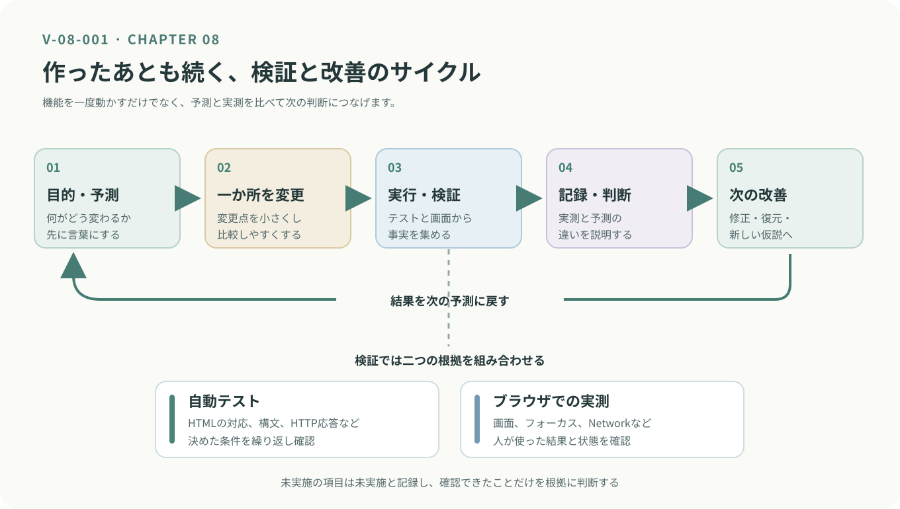

<!-- chapter-id: 08 -->
<!-- goal:  -->
# 第8章　制作の改善と新たな制作のために

## 8.1 知る：制作を終えることと、改善を続けられること

ここまで、HTMLで構造を作り、CSSで見た目を整え、JavaScriptで操作を加えてきました。検索フォームの送信、タブの切り替え、ニュースの取得には、それぞれ異なる役割がありました。第7章では、それらが期待どおりに動かないとき、症状を再現して原因を絞り込む方法を学びました。

最終章では、これらを一つの「New Tab」として捉え直します。**改善していく**という制作のサイクルを、自分で回せるようになることが目標です。

### 8.2 知る：完成版を構成する仕組みを振り返る

| 仕組み | 担当すること | 確認の手掛かり |
| --- | --- | --- |
| HTML | 検索フォーム、タブ、ニュースの表示領域を構成する | Elementsで要素や属性を見る |
| CSS | 色、余白、幅、フォーカス表示を整える | 画面とStylesで適用規則を見る |
| ブラウザ側のJavaScript | タブ操作、フォーカス、ニュースの取得と表示を制御する | Console、Elements、Networkを見る |
| Node.jsサーバー | 静的ファイルの配信、APIキーの管理、外部APIとの通信を担当する | 起動ログとHTTP応答を見る |
| 自動テスト | 決めた条件が満たされるかを繰り返し確認する | テスト名、成功・失敗、エラーを見る |


### 8.12 試す：小さな改善を一つだけ加える

最終章の実験では、一度に多くの変更を行いません。まず完成版の`app.js`で、`keywords`がどこから参照されているかを検索してください。そのうえで、次の一か所だけを変更します。

**変更前（元原稿の抜粋）**

```javascript
const keywords = ['テクノロジー', 'AI', '経済', '政治', '科学'];
```

**変更後（演習用の変更案）**

```javascript
const keywords = ['AI', 'テクノロジー', '経済', '政治', '科学'];
```

保存前に「先頭のジャンル」「表示順序」「何も変わらない」のどれになるかを予測し、再読み込みして確認します。変化がなければ、`keywords`が表示に使われているか、別の配列や既定値が順番を決めているかを調べます。**影響が現れることではなく、影響範囲を見つけることが目的です。**

変更が終わったら、再度自動テストと主要な画面操作を試し、最初の状態に戻します。動作確認の結果を比べるためには、変更前と変更後で同じ手順を使うことが必要です。

### 8.13 考える：次にタブを増やすなら

発展課題として、「New Tab」にもう一つタブを追加する計画を立ててみましょう。いきなりコードを生成するのではなく、まずそのタブの目的と表示内容を決めます。たとえば自分の制作メモを表示したいなら、何を入力し、どこに保存し、いつ読み出す必要があるでしょうか。

HTMLでは、タブの`id`と`aria-controls`、対応パネルの`id`と`aria-labelledby`を対応させます。CSSでは狭い画面での読みやすさ、JavaScriptではタブ配列や数字ショートカットの扱いを確認します。自動テストにもタブとパネルの対応を追加します。

ここで求める成果物は、必ずしも完成したコードではありません。**「追加する機能」「変更するファイル」「確かめる方法」を説明できる設計メモ**を作ってください。生成AIにコード案を求める場合も、まずこのメモと照合し、存在しない関数や属性が混ざっていないかを確認してから採用します。




*図 V-08-001：検証サイクル。自動テストと実際の操作を組み合わせ、確認した事実を次の改善の出発点にする。*

## 8.14 制作を終える前に

プログラムが期待どおりに動いたら、制作はひとまず一区切りです。しかし、自分のパソコンで動くことと、ほかの人がその作品を理解し、使えることは同じではありません。

時間が経ってから自分でコードを開き直したとき、どこから作業を再開すればよいか分からなくなることもあります。

制作を終える前に、作品の使い方や動かすための条件、確認できていることを整理しておきましょう。こうした情報を残すことで、作品をほかの人に渡したり、後から改善したりしやすくなります。

### README.md

プログラムのフォルダには、`README.md`というファイルが置かれていることがあります。

READMEは、その作品が何をするものなのか、どのように使うのかを説明するための文書です。特別なプログラムではなく、Markdownという書き方を使ったテキストファイルです。

本書で制作した「New Tab」にも、READMEを用意してみましょう。最初から長い説明を書く必要はありません。まずは次の内容を、自分の言葉でまとめます。

- **作品の概要：** 何のために作ったアプリなのか。
- **主な機能：** 検索、タブの切り替え、ニュース表示など、何ができるのか。
- **起動方法：** どのような準備や操作をすれば動くのか。
- **利用する仕組み：** Node.jsやGNews APIなど、何に依存しているのか。
- **確認したこと：** どの操作やテストが成功したのか。
- **今後の課題：** まだ直せていない点や、追加してみたい機能は何か。

起動方法には使用したコマンドと必要な設定を記録します。APIキーの値はREADMEに書かず、取得方法と設定方法だけを説明します。

READMEは作品の説明書であると同時に、未来の自分のための記録でもあります。

### 分かりやすい記述の重要性

READMEだけでなく、コードの中にある名前や説明も、読みやすさに関係します。

たとえば、`data`という名前の変数だけでは、何のデータを扱っているのか分かりにくい場合があります。ニュース記事の一覧なら、`newsArticles`のような名前にすることで、役割を想像しやすくなります。

コメントも同様です。コードをそのまま日本語に置き換えるのではなく、「なぜこの処理が必要なのか」「どのような条件を想定しているのか」を補足すると役立ちます。

ただし、名前やコメントだけで分かりやすさが決まるわけではありません。処理が複雑になりすぎていないか、似た処理が何度も書かれていないかも確認しましょう。

読みやすいコードは、ほかの人のためだけのものではありません。数週間後、数か月後に制作を再開する自分にとっても、大切な手掛かりになります。

## 8.15 次の制作のためにできること

### メモを取ろう：アイデアの種を残す

新しい作品のアイデアは、机に向かって考えているときだけに生まれるものではありません。

普段使っているWebサイトで不便に感じたこと、面白いと思った動き、授業で学んだ表現なども、次の制作につながる可能性があります。

思いついたことは、小さなメモとして残しておきましょう。

たとえば、「授業の予定をすぐに確認したい」「好きなジャンルのニュースだけを表示したい」「自分の作業時間を見えるようにしたい」といった内容です。

最初から実現方法まで分かっている必要はありません。まずは「誰が、どのような場面で、何をできるようにしたいのか」を考えてみてください。

「段取り八分、仕事二分」という言葉があります。作業を始める前の準備や計画が、結果に大きく関わるという考え方です。

プログラミングでも、何を作るのかが曖昧なままコードを書き始めると、途中で必要な機能や画面構成が変わり、大きな修正が必要になることがあります。

制作に取りかかる前に、目的、必要な機能、画面の簡単な構成、動作を確かめる方法を整理してみましょう。ただし、計画を完璧にする必要はありません。小さく作って確かめ、必要に応じて計画を見直すことも大切です。

### さまざまな作品から学ぼう：GitHubやCodePen

インターネット上には、世界中の人が作ったプログラムやWebサイトの実例が公開されています。

たとえば、[GitHub](https://github.com/)には、プログラムのソースコードを公開し、変更履歴を管理するための仕組みがあります。ほかの人の作品を調べたり、自分の制作記録を残したりする際にも役立ちます。

[CodePen](https://codepen.io/)では、HTML、CSS、JavaScriptを使ったWeb表現を試すことができます。コードと実行結果を見比べやすいため、気になる表現を調べたり、小さな実験を行ったりするのに適しています。

気に入った作品を見つけたら、見た目だけでなく、どのような構造や処理で実現されているかにも注目してください。

そして、参考にしたコードや素材を自分の作品に取り入れる場合は、必ず利用条件やライセンスを確認しましょう。公開されているという理由だけで、どのような使い方でも許されるわけではありません。

大切なのは、見つけたものをそのまま写すことではなく、「なぜこの仕組みで動くのか」を理解し、自分の目的に合わせて使えるようになることです。

### 車輪の再発明：すべてを自分で作る必要はない

プログラミングには、「車輪の再発明」という表現があります。

すでに誰かが作り、利用できる仕組みを、同じ目的のために最初から作り直すことを指します。

世の中には、便利なライブラリやフレームワーク、さまざまなAPIがあります。これらを適切に利用すれば、すべての機能を一から作ることなく、自分が本当に実現したい部分に時間を使えます。

本書の「New Tab」でも、ニュースそのものを収集するシステムを作る代わりに、GNews APIを利用しました。

一方、学習のために既存の仕組みを自分で作ってみることには意味があります。たとえば、既存のタブ切り替え用ライブラリを利用せず、JavaScriptで切り替えを実装した経験は、画面とプログラムの関係を理解する助けになります。

つまり、車輪を作り直すことが常に悪いわけではありません。

**仕組みを学ぶために自分で作るのか、目的を実現するために既存の仕組みを利用するのか。** その違いを意識して選択できることが重要です。

### 情報デザインを学ぶ私たちが、プログラミングで制作する意義

情報デザインでは、情報を見やすく整理することだけでなく、誰に、何を、どのように伝えるかを考えます。

Webサイトやアプリの場合、利用者が情報を見るだけでなく、検索したり、選択したり、操作したりします。そのため、見た目の美しさと同時に、使いやすさや動作の分かりやすさも考える必要があります。

プログラミングを学ぶことで、自分で考えたデザインを、実際に操作できるものとして形にできます。

たとえば、タブの色を変えるだけならCSSで対応できますが、タブを選択したときに表示内容を切り替えるにはJavaScriptの仕組みが必要です。また、キーボードでも操作できるようにするには、HTMLの構造やフォーカスの動きについても考えなければなりません。

こうした経験を通じて、画面の見た目と、その裏側にある仕組みを結びつけて考えられるようになります。

もちろん、情報デザインを学ぶすべての人が、専門のプログラマーになる必要はありません。しかし、プログラムの基本的な仕組みを理解していれば、実現できる表現を自分で試したり、技術者と具体的に相談したりできるようになります。

生成AIを利用してコードを作る場合も同じです。何を実現したいのかを説明し、提案されたものが目的に合っているかを確かめるためには、デザインと技術の両方の理解が役立ちます。

大切なのは、コードを書くことそのものを目的にしないことです。

**誰のために、何を実現し、その結果をどう確かめるのか。**

この問いを持ちながら制作できることが、情報デザインを学ぶ私たちにとってのプログラミングの意義の一つです。


## 8.16 ふりかえり：この先も自分で学び続けるために

本書では、完成したアプリを最初から一度に理解しようとはしませんでした。HTMLで構造を見つけ、CSSで画面との関係を確かめ、JavaScriptの操作を読み解き、外部APIとの通信を分けて考え、問題が起きたときはテストと開発者ツールで原因を調べてきました。

大切にしたのは、**完成を終点ではなく、次の改善に進める状態として考えること**です。「動いた」という経験だけでなく、「何を確認して動くと判断したか」を自分の言葉で残してください。たとえすべての機能を理解できなくても、一部分を選び、資料を読み、コードを変更し、その結果を確かめられるなら、制作を進めるための確かな手掛かりを持っています。

生成AIや既存のライブラリを使うときも、目的と条件を定め、結果を確認して提案の正しさを判断します。コードと画面、仕様と実装、予測と実測を結び付けながら、自分の興味に合わせて小さな改善を続けてください。


## 8.17 参照資料

以下は、教材で利用する仕組みと設計指針を確認するための資料です。仕様に定義された動作と、本教材で実際に実装された操作は区別して判断してください。

- [W3C WAI: ARIA Authoring Practices Guide — Tabs Pattern](https://www.w3.org/WAI/ARIA/apg/patterns/tabs/) — タブの役割とキーボード操作の設計指針。
- [MDN: HTMLImageElement.loading](https://developer.mozilla.org/ja/docs/Web/API/HTMLImageElement/loading) — 画像の遅延読み込み。
- [MDN: Web Storage API](https://developer.mozilla.org/ja/docs/Web/API/Web_Storage_API) — ブラウザ側の保存領域の違い。
- [MDN: prefers-color-scheme](https://developer.mozilla.org/ja/docs/Web/CSS/Reference/At-rules/%40media/prefers-color-scheme) — 利用者の配色設定に応じたCSS。
- [MDN: ブラウザーの開発者ツールとは](https://developer.mozilla.org/ja/docs/Learn_web_development/Howto/Tools_and_setup/What_are_browser_developer_tools) — 要素や通信の確認。
- [Node.js: Test runner](https://nodejs.org/api/test.html) — `node --test`による検証。
